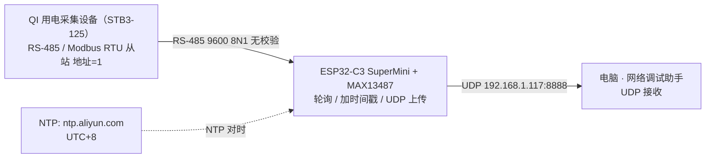

# ESP32-C3 替换树莓派网关项目任务书 v0.3.0

| 项目 | 内容 |
| --- | --- |
| 文档名称 | ESP32-C3 替换树莓派网关项目任务书 |
| 版本 | v0.3.4 |
| 文档状态 | **已冻结（v0.3.0，2026-09-27）** |
| 作者 | WorkBuddy（文档角色） |
| 创建日期 | 2026-09-27（v0.1） |
| 更新日期 | 2026-09-27（v0.3.4） |
| 当前阶段 | **阶段二：环境搭建与基建** |
| 唯一事实来源 | `04_ai_prompts/00_context.md` |
| 关联文档 | `README.md`（第 4 / 6 / 7 / 8 节）<br>`02_docs/02_任务书技术审查_Codex.md`（v0.1 技术审查报告）<br>`02_docs/03_任务书v0.2复查报告.md`（v0.2 复查报告）<br>`02_docs/06_QI协议说明.md`（QI 真实协议）<br>`05_hardware/STB3-125_Modbus_Protocol.md` / `STB3-125_Database_Fields.md` / `STB3-125_Errata.md` |

> **冲突处理规则**：本文档与 `README.md` 或任何其它材料冲突时，**一律以 `04_ai_prompts/00_context.md` 为准**。
> **本文档定位**：项目立项与规划期的共识载体。凡 `00_context.md` 未记录、且本文档标注 `[待确认]` 的内容，均**不得**作为实现依据。

---

## 1. 项目背景与目标

### 1.1 现状（痛点）

- 现有架构使用**树莓派**作为中间数据采集网关，单台成本 **500-800 元**。
- 采集节点数量多，网关按节点铺开部署，**整体成本过高**，不具备规模化推广条件。
- 树莓派作为纯协议转换/转发用途，算力与系统开销严重冗余，属于"用大炮打蚊子"。

### 1.2 目标

| 项 | 内容 |
| --- | --- |
| 替换方案 | **ESP32-C3 SuperMini（约 50 元）+ MAX13487 RS-485 模块** 替换树莓派网关 |
| 降本幅度 | 单节点网关硬件成本从 500-800 元降至 **约 50 元量级**（[待确认] 最终 BOM 以 `05_hardware/` 为准） |
| 本阶段目标 | 先在**面包板**上跑通原型机，验证数据链路端到端可用 |
| 架构动作 | **重写架构**，不复用树莓派时代的软件方案 |

### 1.3 三层数据流（总览）

```
QI 用电采集设备  --(RS-485 / Modbus RTU)-->  ESP32-C3 网关  --(UDP)-->  电脑网络调试助手
   约 300 元                                  约 50 元 + 485 模块        上层接收端
```

| 层级 | 角色 | 职责 |
| --- | --- | --- |
| L1 底层设备 | QI 用电数据采集设备（型号 **STB3-125**，约 300 元） | 支持 RS-485 通信，Modbus RTU 协议，作为数据源。协议见 `02_docs/06_QI协议说明.md` |
| L2 中间网关 | ESP32-C3 SuperMini + MAX13487 | **轮询采集 + 加时间戳 + UDP 上传** |
| L3 上层接收 | 电脑上的"网络调试助手" | 通过 UDP 接收数据（内容为"时间戳 + HEX 数据"） |

### 1.4 成功判定（项目级）

原型机在面包板上，能够以 **1 秒周期**持续从 QI 设备采集数据、附加本地时间戳、通过 UDP 稳定送达电脑端，并完成 2 小时连续压力测试。

---

## 2. 项目范围

### 2.1 本阶段**做**（In Scope）

| 编号 | 范围项 | 说明 |
| --- | --- | --- |
| S-01 | RS-485 轮询 | ESP32-C3 通过 MAX13487 周期性向总线发起查询 |
| S-02 | Modbus RTU 解析 | 解析从站回复帧（CRC 校验、功能码/数据域提取）；QI 协议见 `02_docs/06_QI协议说明.md` |
| S-03 | NTP 对时 | 从 `ntp.aliyun.com` 同步，时区 **东八区 UTC+8** |
| S-04 | UDP 上传 | 将"时间戳 + HEX 数据"发往电脑端网络调试助手 |
| S-05 | 1 秒非阻塞循环 | 用 `millis()` 实现，禁止 `delay()` 阻塞主循环 |
| S-06 | 面包板原型 | 全部验证在面包板 + 杜邦线上完成，不上 PCB |
| S-07 | **最小非阻塞状态机骨架** | `IDLE→TX→WAIT_RX→PARSE→SEND`，**自 M2 起在位**，M6 只加固 |
| S-08 | **WiFi 最小自恢复** | 周期检查 `WiFi.status()` + 节流重连 + 状态日志，**自 M2 起在位** |
| S-09 | **QI 真实协议接入** | M5 起使用 `0x04` 真机帧读取真实测量数据 |

### 2.2 本阶段**不做**（Out of Scope）

以下内容明确排除在本阶段之外，**不得**在阶段一至阶段三的实现中出现：

| 编号 | 排除项 | 备注 |
| --- | --- | --- |
| N-01 | MQTT | 本阶段不引入任何 MQTT Broker / 客户端 |
| N-02 | HTTP / HTTP Server | 不做 REST 接口、不做 Web 配置页 |
| N-03 | 云平台对接 | 不做任何云端上行（阿里云 / 腾讯云 / 自建服务器均不做） |
| N-04 | 成品 PCB | 不画板、不打样，仅面包板原型 |
| N-05 | 锂电池供电 | 本阶段不启用 HW566 的锂电池供电通路，由电脑 USB 供电 |
| N-06 | 多节点 / 多从站组网 | 本阶段只验证**单从站**（设备地址 1）。**已结案**：多从站轮询延后，如需纳入须走 §2.3 变更流程 |
| N-07 | 树莓派侧兼容改造 | 不做旧网关的向后兼容 |
| N-08 | **STB3-125 控制类命令** | 合闸 / 分闸 / 远程锁扣 / 解锁 / 自动 / 手动 / 复位 / 写保持寄存器 / 广播复位**一律禁止执行**。本阶段只读不写 |

### 2.3 范围变更规则

任何超出 2.1 范围的新增需求，必须先回到 `00_context.md` 由用户确认更新，再进入本文档变更记录，**不允许**在执行过程中口头扩范围。

---

## 3. 角色与职责

| 角色 | 定位 | 职责 | 明确不做 |
| --- | --- | --- | --- |
| **用户** | 现场执行者 | 硬件接线、烧录、观察现象、提供日志 | 不负责写代码、不负责写提示词 |
| **总控 AI** | 项目指挥 | 拆解任务、写提示词、审查代码、排障 | 不亲自写下位机业务代码 |
| **Codex** | 代码执行者 | 在工程目录写 / 改代码、编译 | 不改文档决策、不改 `00_context.md` |
| **WorkBuddy** | 文档执行者 | 查资料、写文档、整理测试用例、提炼设备协议 | **不写 ESP32 业务代码** |

### 3.1 交接物约定

| 上游 → 下游 | 交接物 |
| --- | --- |
| 用户 → 总控 AI | 硬件照片、串口日志、现场现象描述 |
| 总控 AI → Codex | 任务拆解 + 提示词（含目标、约束、验收点） |
| Codex → 用户 | 可编译工程 + 烧录指令 + 预期现象 |
| 用户 → WorkBuddy | 运行日志（存入 `03_logs/`）、异常现象、设备原始手册 |
| WorkBuddy → 总控 AI / Codex | 文档、设备协议说明（如 `02_docs/06_QI协议说明.md`）、测试用例、验收记录 |

### 3.2 协作纪律

- 信息流**单向顺序流转**，跨角色信息不得私自跳级；冲突一律回到 `00_context.md` 裁决。
- 同一时刻**只允许一个角色改动同一类文件**：`01_firmware/` 归 Codex，`02_docs/` `06_tests/` 归 WorkBuddy，`00_context.md` 归用户。

---

## 4. 系统架构与数据流

### 4.1 架构图



### 4.2 网络与端口

| 项 | 值 | 状态 |
| --- | --- | --- |
| 网关侧联网方式 | WiFi（STA 模式） | 确定 |
| WiFi 频段要求 | **2.4GHz**（ESP32-C3 不支持 5GHz） | 确定 |
| ESP32 目标 IP | **192.168.1.200**（由 `WiFi.config()` 固定，避开 DHCP 池 .100-.199） | **主方案（Q-02 已更新）**：ESP32 连学校 WiFi、静态固定 IP；路由器侧 DHCP 静态绑定**不可用**（无后台权限）。完整方案见 **§4.2.1** |
| UDP 目标 IP | `192.168.1.117` | **占位符**，阶段二固化为常量（放**入库的** `config.h`）。**每次开工前用 `ipconfig /all` 确认，变化即更新 `config.h`**（见 §4.2.1） |
| UDP 目标端口 | `8888` | **占位符**，阶段二固化为常量（放**入库的** `config.h`） |
| 485 串口参数 | 9600，8N1，**无校验** | **已确认为最终值**（出厂默认；Q-03 已结案） |
| 从站设备地址 | **1** | **已确认**（出厂默认） |
| CRC | CRC16/Modbus（初值 `0xFFFF`、多项式 `0xA001`、**低字节先发**） | 确定，见 6.4 |

### 4.2.1 网络环境约束（实测）

用户电脑无线网卡实测（2026-09-27）：

| 项 | 值 |
| --- | --- |
| 网卡 | 无线局域网适配器 WLAN |
| 电脑 IPv4 | 192.168.1.117 |
| 子网掩码 | 255.255.255.0 |
| 默认网关 | 192.168.1.1 |
| 网段 | 192.168.1.0/24 |

⚠️ 电脑另有 VMware VMnet1 (192.168.178.1) 与 VMnet8 (192.168.254.1) 两张虚拟网卡，**与本项目无关，配置时认准 WLAN**。

**网络管理约束：**

1. 路由器由学校统一管理，用户**无后台权限**，无法做 DHCP 静态绑定（Q-02 原方案不可执行）。
2. 无法更换 WiFi 密码（R-04 缓解措施不可执行）。
3. **已确认**：该 WiFi **不需要网页登录**（无学号/密码认证页）→ **ESP32 可直连**。
4. **已确认**：**手机 2.4GHz 热点可行**（用户已确认）→ 退路已就绪。
5. **唯一剩余风险**：客户端隔离（AP isolation）是否开启 → M1 用 ping 实测。

**网络方案（按优先级）：**

- **主方案**：ESP32 连学校 WiFi，用 `WiFi.config(192.168.1.200, 192.168.1.1, 255.255.255.0, 192.168.1.1)` 固定 IP（选 192.168.1.200，远离常见 DHCP 池 .100-.199）。
  - **M1 前置（静态 IP 空闲确认）**：固定 192.168.1.200 之前，先在电脑执行 `ping 192.168.1.200` 与 `arp -a`，确认该 IP 无人占用；若已占用，改用 192.168.1.201~.210 中未被占用的地址。
  - **M1 前置（SSID 频段确认）**：用手机 WiFi 分析 App（WiFi Analyzer / 网络百宝箱等）确认要连的 SSID 在 2.4GHz 频段独立可连。若该 SSID 是 2.4/5 合并广播，ESP32-C3 能否抓到取决于路由器实现；抓不到则退到手机热点。
- **退路**：若 M1 实测 ping 不通（客户端隔离开启），电脑与 ESP32 都改连**手机 2.4GHz 热点**。热点由用户控制，无隔离、无登录页。
- **电脑侧**：接受 IP 可能漂移。每次开工前 `ipconfig /all` 确认，若变化则更新 `config.h` 中的 `UDP_TARGET_IP`。

**NTP 网络风险（M2 前置，总控裁定）：**

校园网可能屏蔽 UDP/123 端口或不下发外部 DNS，导致 ntp.aliyun.com 同步失败。M2 开测前必须先做如下验证：

1. **电脑侧**：cmd → `nslookup ntp.aliyun.com`，看是否解析；通 → 继续；不通 → 直接走第 3 条。
2. **ESP32 侧**：用 `ntp.aliyun.com` 做 NTP，观察串口是否出现 `UNSYNCED`；同步成功 → 主路径成立。
3. **若 NTP 不通**：改用 **IP 直连 NTP**（如 `203.107.6.88`，阿里 NTP 公共 IP），仍不通则退到**手机热点**验证（手机热点通常不屏蔽 NTP）。

此条**直接影响 M2 验收，必须在 M2 开始前闭环**。

### 4.3 1 秒循环数据流（软件主流程）

| 步 | 动作 | 关键约束 |
| --- | --- | --- |
| 4.0 | **周期基准在周期开始打点** | 用 `nextPoll += 1000`（**不是** `now + 1000`），防止周期漂移；`millis()` 比较必须用**无符号减法**（防 49.7 天溢出） |
| 4.1 | 向 485 总线发送 Modbus RTU 查询帧 | **M3/M4 用 0x03 回环自测帧；M5 起用 0x04 真机帧**，见 6.4 |
| 4.2 | **等待发送完成** | 用 `Serial1.flush()` 等待 FIFO 与移位寄存器排空；随后**显式清空 RX 缓冲区**，再开始收帧计时 |
| 4.3 | 接收 485 设备回复数据 | **两级超时 + 帧长驱动**：首字节等待 50-100ms；字符间隔 3-5ms；**收满预期帧长即结束**；**300ms 仅作兜底上限**（详见 6.1.2） |
| 4.4 | 解析回复数据并拼接时间戳 | 格式：`YYYY-MM-DD HH:MM:SS \| HEX数据`；时间源与降级见 6.2 |
| 4.5 | 通过 UDP 发送到电脑网络调试助手 | 目标见 4.2（均为占位符） |
| 4.6 | 等待下一次 1 秒定时触发 | **非阻塞 deadline 调度**，禁止 `delay()`；重试总预算 ≤300ms 或不跨周期 |

> **总线占用检测说明（v0.2.1 新增）**：软件侧无法检测总线是否被占用（MAX13487 AutoDirection **无状态反馈**）；总线冲突只能由“**应答超时 + CRC 失败**”间接覆盖。**不要引入 GPIO 轮询式的“总线忙”判断** —— 本项目硬件不具备该能力。

---

## 5. 硬件清单与致命接线规范

### 5.1 硬件清单

| 器件 | 型号 / 规格 | 供电 | 备注 |
| --- | --- | --- | --- |
| 主控板 | **ESP32-C3 SuperMini（主控板 PCB 型号 HW-466AB）** | 3.3V 逻辑 | 使用 `HardwareSerial(1)`，**RX=GPIO20，TX=GPIO21**。⚠️ GPIO20/21 同时是 ESP32-C3 **UART0 的默认引脚**；用 UART1 复用它们必须把 Arduino IDE 的 **USB CDC On Boot 设为 Enabled**，让 `Serial` 走 USB Serial/JTAG（GPIO18/19），否则日志与 485 直接冲突。**形参顺序**：`Serial1.begin(9600, SERIAL_8N1, 20, 21)`（**baud, config, rxPin, txPin → 20=RX, 21=TX**），写反的现象是"什么都收不到"，极易误判为硬件故障 |
| 扩展底板 | **HW566 V0.0.1** 扩展板 | 提供 5V / 3.3V / 锂电池供电接口 | **面包板阶段先不用**，由电脑 USB 供电；留到阶段四/五上锂电池时再用 |
| 通信模块 | **MAX13487** RS-485 模块 | **+5V** | AutoDirection 自动方向控制，无需 DE/RE 控制引脚。**注意：软件无法观察 TX/RX 方向状态**，发送完成判据必须显式处理（见 6.1.2） |
| 采集设备 | QI 用电数据采集设备（型号 **STB3-125**，约 300 元） | — | RS-485 / Modbus RTU，地址 1；真机接入属 M5 |
| 调试工具 | USB 转 485 模块 | — | 用于 M3 物理回环 / M4 电脑模拟从站；通常自带 120Ω 终端 |

**供电路径（面包板阶段）**：电脑 USB → ESP32-C3 SuperMini → SuperMini 的 **5V 引脚** → MAX13487。
HW566 V0.0.1 在面包板阶段**不接入**，此决定已由总控确认。

### 5.2 ⚠️ 致命接线警告（必须遵守）

> 1. ⚠️ **共地**：ESP32、MAX13487、USB转485模块、电源，所有 GND 必须连在一起。
>    - 补充：若两端由**不同电源**供电，须确认共模电压在 −7V ~ +12V 内（极端场景需加隔离）；尽量**单点接地**，避免地环路。
>
> 2. ⚠️ **电平转换（极其重要）**：**上电前必须用万用表实测 MAX13487 的 RXO 空闲电平：若为 5V 用 1k/2k 分压；若已是 3.3V 则直连 GPIO20，不再分压。** MAX13487 的 RXO 输出通常是 5V 电平，此时绝对不能直接连 ESP32 的 RX (GPIO20)，必须加电阻分压。正确分压：1kΩ接RXO，2kΩ接GND，交点接GPIO20（电压约3.33V）。严禁使用 2k接RXO，1k接GND（电压仅1.67V，ESP32无法识别高电平）。
>    - 核验依据：ESP32-C3 的 VIH = 0.75 × 3.3V = **2.475V**，3.333V 合格（余量 0.858V）；且 3.333V < 绝对最大额定 3.6V。
>    - **反向警告**：若该模块板载了电平转换、RXO 本身已是 3.3V 输出，再加此分压会得到 2.2V，**低于 VIH → 链路直接不可用**。这就是必须先实测的原因。
>    - 术语说明：模块侧该 5V 输出脚在本文档中**统一写作 `RXO`**（部分手册/资料记作 `RO` 或 `RXD`，同一引脚）。
>
> 3. ⚠️ **供电**：MAX13487 必须接 5V，ESP32-C3 接 3.3V。
>
> 4. ⚠️ **总线偏置**：MAX13487 模块自带 4.7kΩ 偏置电阻和 120Ω 终端电阻。
>    - **多节点并联核算（M3/M4 必然遇到）**：MAX13487 模块 + USB 转 485 模块（通常也自带 120Ω）挂同一条总线时，终端并联约 **60Ω**，偏置并联约 **2.35kΩ**。驱动器带 60Ω 属 RS-485 额定测试条件，通常可行；**但需在 M3 实测确认**。
>    - 单模块空闲差分电压仅约 **63mV**（5V × 120/(4700+120+4700)），**低于 RS-485 判定阈值 200mV**，能否可靠保持空闲电平取决于 MAX13487E 是否具备 true fail-safe 接收器，**需查手册确认**。
>    - 原则：总线两端各 1 个 120Ω，中间节点不装；后续再接 QI 真机（第 3 个节点）需重新核算。
>
> 5. ⚠️ **EN引脚**：**含义待 M1 实测确认**（MAX13487 模块丝印为 EN，可能对应 RE# 或 DE，含义不同接法不同）。**未确认前保持断开——既不接 3.3V，也不接 GND，也不接线，待 M1 实测后再按结论接入。**
>    - 风险说明：若该脚实为 **DE（驱动使能）**，接高会**强制驱动器一直使能、长期占用总线**，导致收不到任何从站数据、与其它节点冲突甚至发热；若实为 **RE#（接收使能，低有效）**，接高会**关闭接收器**，同样收不到数据。**这两种接法都是功能性致命错误**，因此未确认前一律断开。
>
> 6. ⚠️ **TX 侧电平（新增）**：ESP32 的 **GPIO21（TX）→ MAX13487 的 DI** 由 3.3V 驱动，而模块为 5V 供电。需按模块手册核对 **DI 的 VIH ≤ 3.3V**（多数 MAX13487E 为 TTL 兼容，VIH 约 2.0V，可行）。v0.1 只讲了 RX 侧分压，**遗漏了 TX 侧**。
>
> 7. ⚠️ **上电顺序（新增）**：避免"5V 已上、3.3V 未上"的窗口，否则分压后的 3.33V 会灌入未上电的 GPIO20。**两者应同时上电**（同一 USB 供电天然满足）。
>
> 8. ⚠️ **接线长度与走线（新增）**：9600 速率下几米杜邦线可用，但要避免与强电/电机线并行；分压点引入的额外杜邦线要尽量短（减少噪声与容性负载）。

### 5.3 接线自检清单（上电前逐项打勾）

- [ ] 所有模块 GND 已共地（含 USB 转 485）
- [ ] RXO —[1kΩ]— 分压节点 —[2kΩ]— GND；分压节点接 GPIO20。**严禁只串 1kΩ 直连**（5V 经 1kΩ 直入 GPIO20 会超出 3.6V 绝对最大额定，可能永久损坏引脚）
- [ ] **RXO 空闲电平已用万用表实测**，确认是否真的需要分压（5V → 分压；3.3V → 直连）
- [ ] MAX13487 接 5V，ESP32-C3 接 3.3V
- [ ] **EN 引脚保持断开（未接任何电平、未接线），待 M1 实测后接入**
- [ ] TX（GPIO21）→ DI 的逻辑电平兼容性已按手册核对
- [ ] 两者同时上电（无"5V 先上、3.3V 后上"窗口）
- [ ] 未接入 HW566 及锂电池
- [ ] A/B 线未接反，且**整条总线的 A/B 定义统一**（[待确认] 模块与设备丝印，需实物核对）
- [ ] 总线终端电阻数量已统计（理想：两端各 1 个 120Ω；多节点并联时按 5.2 第 4 条核算）
- [ ] 发送后接收缓冲区**无自回收残留**（M3 用日志验证）

---

## 6. 软件功能需求

### 6.1 功能需求清单

| ID | 功能 | 需求描述 | 约束 / 备注 |
| --- | --- | --- | --- |
| FR-01 | WiFi 联网 | ESP32-C3 以 STA 模式连接 2.4GHz 局域网，获得与电脑同网段的 IP | **凭据不写明文**：`SSID` / 密码由 `01_firmware/esp32c3_gateway/secrets.h` 承载，**不入库**，`.gitignore` 已忽略。详见 6.1.1 |
| FR-02 | NTP 对时 | 从 `ntp.aliyun.com` 同步时间，时区 **UTC+8**，获得准确本地时间 | 建议一次调用 `configTzTime("CST-8", "ntp.aliyun.com")`，避免手工 ±8 小时运算出错。⚠️ TZ 串**不可加尖括号**：`"<CST-8>"` 会被 POSIX TZ 解析为'分区名字面量'、偏移量缺省为 0 → 等效 UTC（曾导致时间差 8 小时）。正确写法是 `"CST-8"`。**SNTP 必须在 WiFi 连上之后再初始化；WiFi 断开/重连成功后需重新触发一次 `configTzTime`。** 断电重启后需具备重新对时能力 |
| FR-03 | RS-485 通信 | 通过 MAX13487 收发，**9600，8N1 无校验**，从站地址 1 | MAX13487 自动收发，无控制引脚；**必须** `USB CDC On Boot = Enabled` + 显式传引脚（见 5.1） |
| FR-04 | Modbus RTU 收发与解析 | 组装请求帧、发送、按**两级超时**收帧、CRC 校验、提取数据域 | 详见 6.1.2（发送完成判据 / 清空 RX / 帧长驱动 / 超时分级）；协议见 `02_docs/06_QI协议说明.md` |
| FR-05 | UDP 上传 | 将"时间戳 + HEX 数据"发给电脑网络调试助手 | 目标 `192.168.1.117:8888` 为**占位符**，常量放入库的 `config.h` |
| FR-06 | 1 秒非阻塞循环 | 基于 `millis()` 的 1 秒周期调度 | **禁止** `delay()` 阻塞式实现；周期基准在周期开始打点（见 4.3） |
| **FR-07** | **主循环为单状态机** | 主循环为 `IDLE→TX→WAIT_RX→PARSE→SEND` 单状态机，**禁止任何阻塞等待**；所有等待以 **deadline** 形式表达 | **M2 起即交付最小版**（TX/WAIT_RX 分支可先留空，只跑调度 + WiFi/NTP/UDP），**M6 只加固不重构** |
| **FR-08** | **时间戳来源** | 时间戳取 **NTP 同步后的墙钟**；`millis()` **仅用于周期调度**，不作为时间戳 | 未同步时的降级规则见 **6.2** |
| **FR-09** | **WiFi 最小自恢复** | `WiFi.status()` 周期检查 + **节流重连** + 状态变化日志 + 重连计数 | **M2 交付**。`WiFi.setAutoReconnect(true)` 且 `WiFi.persistent(true)`，但**不得只依赖它**；重试节流 ≥5s；**绝不允许** `while (WiFi.status() != WL_CONNECTED) delay(...)` 阻塞连接 |

#### 6.1.1 FR-01 明细（凭据与常量管理）

1. **include 写法**：`.ino` 与 `secrets.h` **必须同目录**（`01_firmware/esp32c3_gateway/`）；写 `#include "secrets.h"`（引号形式），**不要**写 `<secrets.h>`。
2. **编译期守卫**（避免"忘了建 secrets.h 却编译通过、运行时连不上"）：
   ```cpp
   #include "secrets.h"
   #ifndef WIFI_SSID
   #error "secrets.h 缺失或未配置：请复制 secrets.h.example 为 secrets.h 并填写"
   #endif
   ```
3. **`secrets.h` 只放凭据**：`WIFI_SSID` / `WIFI_PASSWORD`。
4. **拆出入库的 `config.h`**：`UDP_TARGET_IP` / `UDP_TARGET_PORT` / `NTP_SERVER` / 485 波特率 / 超时等**非敏感常量**放这里。理由：这些正是 §4.2 要求"阶段二固化为常量"的受控参数，放入库文件才能被评审与 diff 追踪。
5. **入库模板 `secrets.h.example`**（仅占位符，无真实凭据）：`.gitignore` 的 `secrets.h` 是精确文件名匹配，`.example` **不会被忽略**，可正常入库。
6. **纪律**：不得把凭据写进 `.ino`；不得在串口日志中打印 SSID / 密码；`secrets.h` 不得出现在截图或粘贴的编译日志里。

#### 6.1.2 FR-04 明细（发送完成判据与收帧）

1. **发送完成后必须调用 `Serial1.flush()`**（等待发送 FIFO 与移位寄存器全部排空），这是**唯一可靠的"发完"判据**。
2. **随后显式清空 RX 缓冲区**，再启动收帧计时。成本几乎为零，可抵消"驱动释放与接收使能翻转窗口"导致的首字节丢失或自回收残留。
3. **禁止固定 `delay()` 作为发送完成判据**（波特率或帧长一变就失效）。
4. `flush()` 返回后驱动**可能仍未释放**，因此读之前给一个**可配置小间隔（建议 100-200μs）**作为工程容错，必须写成常量并注明理由。
5. **收帧判据为帧长驱动**：读寄存器类响应的长度 = `3 + 2N + 2`（N 为寄存器数）；收满即结束，不再空等 300ms。
6. **超时分级**（相对 9600 8N1，1 字符 ≈ 1.0417ms）：

   | 级别 | 先验值（M3/M4 直接用） | 收紧目标 | 作用 |
   | --- | --- | --- | --- |
   | 首字节等待超时 | **50-100ms** | **20-30ms** | 从站完全不响应时快速失败 |
   | 字符间隔超时 | **3-5ms**（Modbus 标准 1.5 字符 ≈ 1.56ms，留容错） | **3ms** | 帧中途断流时判定帧结束/异常 |
   | 整帧兜底上限 | **300ms** | **150-200ms** | 仅作最终兜底，不再是主要判据 |

   > **字符间隔 ≠ 整帧上限。** 0x04 读 39 个寄存器全帧 83 B ≈ **86.5ms**，兜底不建议 <120ms。

7. **重试**：若实现重试，**重试总预算 ≤300ms 或不跨周期**。反例：3 次重试 × 300ms 固定超时 ≈ 925ms，叠加解析与 UDP 会**溢出 1 秒周期**，直接违反 M6 的周期抖动指标。

### 6.2 时间戳格式、来源与降级

**格式（固定）**：

```
YYYY-MM-DD HH:MM:SS | HEX数据
```

示例（示意，非真实数据）：

```
2026-09-27 16:58:43 | 01 04 02 00 0A 39 37
```

**时间源与降级规则**：

| 项 | 规则 |
| --- | --- |
| 主源 | **NTP 同步后的墙钟**（UTC+8 本地时间）。`millis()` **只用于调度，不作为时间戳** |
| 同步判据 | `epoch > 1700000000`（2023-11-15 之后）视为已同步，或用 `sntp_get_sync_status()` |
| **降级（关键）** | 未同步时**不得**输出墙钟（否则会打印 `1970-01-01 08:00:00`，下游看起来像正常数据 —— 最危险的静默错误）。改为 `BOOT+<秒>.<毫秒>`（如 `BOOT+000123.456`），并在同一行加 **`UNSYNCED`** 标记 |
| 恢复 | 同步恢复后立即切回墙钟，**并打印一条状态切换日志** |
| 重同步 | WiFi 重连成功后立即触发一次 SNTP；正常运行每 6-12 小时重同步一次 |
| 漂移说明 | 断网**不会**让时间戳失效：SNTP 成功后靠内部 RTC 继续走时（数十 ppm，数小时内秒级精度够用）。真正需要降级的只有两类：① 冷启动且从未同步成功；② 长时间断网导致的缓慢漂移（2 小时压测可忽略，M6 记录） |
| 同秒重复取舍 | 1 秒粒度下**相邻两包时间戳可能相同** —— **已定（总控裁定）：不加毫秒、不加序号**（下游为 NetAssist 人眼观察，不需要唯一性；加了反而增加解析复杂度）。若 M5/M6 发现下游需要，再走变更流程。见 11.3 **Q-12** |

### 6.3 通信参数汇总

| 参数 | 值 | 来源 |
| --- | --- | --- |
| NTP 服务器 | `ntp.aliyun.com` | 00_context 四.2 |
| 时区 | UTC+8（东八区） | 00_context 四.2 |
| 485 波特率 | **9600（最终值）** | 00_context 四.3 + STB3-125 出厂参数；**Q-03 已结案** |
| 数据位/校验/停止位 | **8N1，无校验** | 00_context 四.3 + STB3-125 出厂参数 |
| 从站地址 | **1** | STB3-125 出厂参数 |
| CRC | CRC16/Modbus，初值 `0xFFFF`，多项式 `0xA001`，**低字节先发** | 00_context 四.4.1（复核见 Codex 报告附录 A.1） |
| 首字节等待超时 | 50-100ms | 本次新增（6.1.2） |
| 字符间隔超时 | 3-5ms | 本次新增（6.1.2） |
| 整帧兜底超时 | **300ms** | 00_context 四.4.2 |
| 周期基准 | 1000ms，**周期开始打点**（`nextPoll += 1000`） | 本次新增（4.3） |
| UDP 目标 | `192.168.1.117:8888` | 00_context 四.4.4（**占位符**） |

### 6.4 回环自测帧与 QI 真机帧

**（1）回环自测帧 —— 功能码 0x03，仅 M3 / M4 使用**

```
{0x01, 0x03, 0x00, 0x00, 0x00, 0x02, 0xC4, 0x0B}
```

- 用途：**M3 物理回环**、**M4 电脑模拟 Modbus 从站**，验证请求组装、CRC、两级超时、帧长驱动收帧、解析全流程。
- **CRC 固化说明**：CRC16/Modbus，**初值 `0xFFFF`，多项式 `0xA001`，低字节先发**。已独立复核：CRC 字 = `0x0BC4` → 线上 `0xC4, 0x0B` ✓。
- M5 之后**保留作调试开关**，但默认关闭，且日志必须打印当前帧类型。

**（2）QI 真机帧 —— 功能码 0x04，M5 起使用**

```
{0x01, 0x04, 0x00, 0x00, 0x00, 0x27, 0xB0, 0x10}     // 读全部 39 个输入寄存器
{0x01, 0x04, 0x00, 0x09, 0x00, 0x01, 0xE1, 0xC8}     // 读 A 相电流
```

- **QI 真实协议见 `02_docs/06_QI协议说明.md`**；M3/M4 用 `0x03` 回环帧，**M5 起用 `0x04` 真实帧**。
- 两类帧**禁止混用**，边界规则见该文件第 6 节。
- `0x27` = 39 个寄存器，超出协议原文"数据长度不能超过 16"的自述上限，**需真机验证**（见 `06_QI协议说明.md` 的 `E-02`）。
- **M5 实测前默认走 3 段读取（v0.2.1 新增）**：**M5 实测前，固件默认走 `06_QI协议说明.md` 的 E-02 3 段读取方案（S1: `01 04 00 00 00 10 F1 C6`；S2: `01 04 00 10 00 10 F0 03`；S3: `01 04 00 20 00 07 B0 02`），以编译期宏 `QI_READ_SPLIT_3SEG` 切换。真机接受 `00 27` 一帧读全后再删分段路径，并回写 `06_QI协议说明.md` 第 7 节。**（E-02 的细化帧、预期响应长度 37/37/19 字节与合并解析逻辑见 `05_hardware/STB3-125_Errata.md` 第 4 节 B 方案）

### 6.5 明确禁止的实现方式

- ❌ 使用 `delay(1000)` 之类阻塞调用实现"1 秒循环"（见 FR-06 / FR-07）
- ❌ 用固定 `delay()` 作为**发送完成判据**（见 6.1.2）
- ❌ 将 WiFi 凭据硬编码进 `.ino` / 非 `secrets.h` 的 `.h` 文件；或在串口日志/截图中泄露凭据
- ❌ 从站无响应时无限等待（必须有首字节超时 + 字符间隔超时 + 300ms 兜底）
- ❌ 未同步时间时输出墙钟（会产生 `1970-01-01` 这类**看起来正常**的伪数据）
- ❌ 引入 MQTT / HTTP / 云平台相关依赖（见 2.2）
- ❌ `while (WiFi.status() != WL_CONNECTED) delay(...)` 阻塞式连接/重连（见 FR-09）
- ❌ 把 `0x03` 回环自测帧当作 QI 轮询帧长期使用（会读到保持寄存器内容，语义完全错误）
- ❌ 执行 STB3-125 控制类命令（合闸 / 分闸 / 锁扣 / 解锁 / 自动 / 手动 / 复位 / 写保持寄存器，见 2.2 N-08）
- ❌ 在未真机验证前把 QI 寄存器地址写死进生产代码（见 `06_QI协议说明.md` 第 9 节）

---

## 7. 阶段与里程碑

### 7.1 里程碑定义

| 里程碑 | 名称 | 对应项目阶段 | 交付核心 |
| --- | --- | --- | --- |
| **M0** | 任务书冻结 | 阶段一 项目立项与规划 | 本文件评审通过并冻结 |
| **M1** | 环境搭建 | 阶段二 环境搭建与基建 | 软件、硬件、COM 号、IP、同网段全部确认 + 编译选项与最小 UART1 回环自检通过 |
| **M2** | ✅ **WiFi / NTP / UDP 联通（已完成）** | 阶段三 分模块验证 | **WiFi/NTP/UDP 联通 + 最小非阻塞状态机骨架（IDLE→TX→WAIT_RX→PARSE→SEND）** |
| **M3** | ✅ **485 物理回环（已完成）** | 阶段三 分模块验证 | 串口物理层收发正确（含发送完成判据与自回收验证） |
| **M4** | 电脑模拟 Modbus 从站 | 阶段三 分模块验证 | 协议层解析正确（含超时与 CRC 容错） |
| **M5** | 接入 QI 真机 | 阶段三 分模块验证 | 真实数据上链（依据 `02_docs/06_QI协议说明.md`） |
| **M6** | 系统集成与 2 小时压力测试 | 阶段四 系统集成与稳定性 | **非阻塞状态机加固** + 异常处理 + 稳定性达标 |
| **M7** | 验收结项 | 阶段五 项目验收与结项 | 成本对比、交付物整理、演示 |

### 7.2 里程碑推进顺序


**铁律**：顺序推进，**先软后硬、先模拟后真机**。上一里程碑未通过验收（见第 9 节），不得启动下一个。

**状态机口径（总控裁定）**：**M2 起即采用最小状态机；M6 只做加固，不做重构。**
理由：M2 的验收（连续 ≥60s 每秒一包 + 周期检查 WiFi/NTP）在禁止 `delay()` 的前提下**事实上有且仅有一个非阻塞调度骨架**，状态机不是"提前引入的复杂度"，而是同一件事；若拖到 M6 才重写主干，M3-M5 的全部验收证据将作废，必须重跑。

### 7.3 M1 环境搭建的展开项（防遗漏）

| 项 | 内容 | 当前状态 |
| --- | --- | --- |
| 软件 | Arduino IDE 2.3.10 已安装（Windows） | 已具备 |
| 开发板包 | ESP32 开发板包 | **卡在 `esp-rv32@2601`（ESP32-C3 是 RISC-V 芯片，需 esp-rv32 工具链），未安装成功** |
| **编译选项** | Arduino IDE → **USB CDC On Boot = Enabled**（否则 `Serial` 占用 GPIO20/21，与 `Serial1` 直接冲突） | **待设置** |
| **最小 UART1 回环自检** | GPIO21 短接 GPIO20，用 USB CDC 打印收发结果 | **待执行**（同时验证 M3 前置条件） |
| **万用表实测 RXO 空闲电平** | 给模块上 5V（**不接 ESP32**），量 RXO 空闲电平，决定分压 or 直连 | **待执行（高优先级）** |
| **EN 引脚含义确认** | 核对实物丝印 + MAX13487 手册，确定该脚是 RE# 还是 DE；未确认前保持断开 | **待执行（高优先级）** |
| COM 号 | 烧录串口号查询 | 待查询 |
| 电脑 IP | 192.168.1.117 | 已知；**不可做 DHCP 静态绑定**（学校统一管理、无权限）→ 每次开工前 `ipconfig /all` 确认，变化即更新 `config.h`（见 §4.2.1 / R-09） |
| 网段 | ESP32（2.4GHz）与电脑必须同一局域网 / 同一网段。电脑侧频段未实测，以 M1 实测为准；频段差异本身不是网段不一致的判据。待实测客户端隔离（AP isolation），见 R-11。 | **未验证** —— 网段已确认为 **192.168.1.0/24**（§4.2.1）；**待实测客户端隔离（AP isolation）**，见 R-11：`ping 192.168.1.200` 通 → 主方案；不通 → 手机热点退路 |
| 静态 IP 空闲确认 | 在电脑 `ping 192.168.1.200` + `arp -a`，确认未占用 | **待执行（高优先级）** |
| SSID 频段确认 | 用手机 WiFi 分析 App 确认 SSID 在 2.4GHz 独立可连 | **待执行** |
| 硬件 | **ESP32-C3 SuperMini 主控板（PCB 型号 HW-466AB）**、HW566 V0.0.1 扩展底板、MAX13487、面包板 | 已就位（已拍照确认） |

### M2 实测结果（2026-09-27）

| 项 | 结果 | 依据 |
| --- | --- | --- |
| WiFi 静态 IP | ✅ 192.168.1.200 成功 | 串口 `[WIFI] 已连接 SSID=... IP=192.168.1.200` |
| NTP 同步 | ✅ 成功（修复后） | 串口 `[NTP] 时间已同步：本地 2026-09-27 20:40:03 +0800` |
| UDP 每秒发包 | ✅ 成功 | NetAssist 每秒一行 `YYYY-MM-DD HH:MM:SS \| M2_HEARTBEAT`，源 192.168.1.200:12345 |
| 最小状态机骨架 | ✅ 已在位 | `enum GatewayState {ST_IDLE, ST_TX, ST_WAIT_RX, ST_PARSE, ST_SEND}`，仅 ST_SEND 有实体逻辑 |
| WiFi 自恢复 | ⏳ 待 M6 压测验证 | 代码已实现，未人为断网验证 |
| 偶发丢包 | ✅ 观察通过，1 分钟丢包率低，满足 M2 判据（<1%）；M6 压测再收口 | 1 分钟观察已完成；偶发跳秒已判定为可接受；完整收口归 M6 压测 |
| 关键 bug | ✅ 已修 | 时区不生效根因 = `"<CST-8>"` 尖括号；已提交 044242c |

### M3 实测结果（2026-09-27）

| 项 | 结果 | 依据 |
| --- | --- | --- |
| UART1 物理回环 | ✅ 通过 | 串口每秒 `[485] 回环 OK TX=8 RX=8 \| 01 03 00 00 00 02 C4 0B` |
| 连续 1 分钟统计 | ✅ 成功 60+ / 失败 0 / 超时 0 | 串口统计行 |
| M2/M3 共存 | ✅ 每秒 M2_HEARTBEAT + 485 回环并行输出 | 两行串口同屏 |
| 状态机填充 | ✅ IDLE→TX→WAIT_RX→PARSE→SEND 全跑通 | 已提交 08002ca |

---

## 8. 交付物与目录结构

### 8.1 工程目录

```
ESP32_C3_Gateway/
├─ 01_firmware/               固件工程（唯一可编译产物来源）
│  └─ esp32c3_gateway/        ESP32-C3 RS-485 采集网关固件主工程
├─ 02_docs/                   设计文档、协议说明、接线说明、调试记录
├─ 03_logs/                   串口日志、抓包、调试输出（不入库）
├─ 04_ai_prompts/             与 AI 协作使用的提示词、上下文模板
├─ 05_hardware/               原理图、PCB、BOM、器件手册、引脚分配表
├─ 06_tests/                  测试用例、测试脚本、测试报告
├─ README.md                  项目总览
└─ .gitignore                 Git 忽略规则
```

| 目录 | 职责 | 是否入库 |
| --- | --- | --- |
| `01_firmware/` | 全部固件源代码与工程配置 | 是（编译产物除外） |
| `02_docs/` | 文档、图纸外的说明性材料 | 是 |
| `03_logs/` | 运行时日志、临时调试数据 | 否（仅保留目录） |
| `04_ai_prompts/` | AI 协作提示词与上下文文件 | 是 |
| `05_hardware/` | 硬件资料 | 是（大文件建议另存） |
| `06_tests/` | 测试资产 | 是 |

> 目录编号使用两位数字前缀以固定排序，**请勿改名**。

### 8.2 分阶段交付物

> **编号说明**：`02_docs/02_` 已被技术审查报告占用，环境搭建记录等**整体顺延**；`02_docs/06_QI协议说明.md` 已于本轮入库并固定占用 `06_`。

| 里程碑 | 交付物 | 路径 |
| --- | --- | --- |
| M0 | 项目任务书（本文件） | `02_docs/01_项目任务书.md` |
| M0 | 任务书技术审查报告 | `02_docs/02_任务书技术审查_Codex.md`（已完成） |
| M1 | 环境搭建记录（COM 号、IP、网段、开发板包版本、编译选项、UART1 回环、RXO/EN 实测结论） | `02_docs/03_环境搭建记录.md` |
| M1 | 接线说明 / 引脚分配表 | `05_hardware/接线说明.md` |
| M1 | **凭据模板（入库，仅占位符）** | `01_firmware/esp32c3_gateway/secrets.h.example` |
| M1 | ESP32 开发板包排障文档 | `02_docs/11_esp32开发板包排障.md`（已完成，提交 aae2c8d） |
| M1 | 固件工程骨架（空壳，无业务代码） | `01_firmware/esp32c3_gateway/`（已完成，提交 c37afa5） |
| M2 | 网络联通记录 + 串口日志 | `02_docs/04_网络联通记录.md`、`03_logs/` |
| M3 | 485 回环测试记录（发帧/收帧 HEX 对照 + 1000 帧统计 + 终端电阻统计） | `02_docs/05_485回环记录.md` |
| — | **QI 真实协议说明** | `02_docs/06_QI协议说明.md`（本轮入库） |
| M4 | 模拟从站测试用例 + 记录 | `06_tests/`、`02_docs/07_模拟从站记录.md` |
| M5 | 真机联调记录（含与 QI 本机显示的 ≥20 组对照） | `02_docs/08_真机联调记录.md` |
| M5 | 协议勘误表 | `05_hardware/STB3-125_Errata.md`（Codex 产出） |
| M6 | 压力测试报告（2 小时） | `06_tests/压力测试报告.md` |
| M6 | 固件工程（可编译） | `01_firmware/esp32c3_gateway/` |
| M7 | 成本对比表（树莓派 vs ESP32-C3） | `02_docs/09_成本对比.md` |
| M7 | 交付物清单 + 演示材料 | `02_docs/10_验收结项.md` |

### 8.3 交付物命名与提交约定

- 提交信息格式：`阶段N: 简述`，例如 `阶段1: 任务书升级至 v0.2.7`
- 日志文件统一放 `03_logs/`，不入库；需长期留存的结论必须转写到 `02_docs/` 或 `06_tests/`。
- `secrets.h` 不入库；`secrets.h.example`（仅占位符）**入库**。
- 文档类改动尽量避免与代码改动混在同一提交。

---

## 9. 验收标准

### 9.1 分阶段验收表

| 里程碑 | 应观察到的现象 | 应留存的日志 | 测量方法与工具 | 成功条件 |
| --- | --- | --- | --- | --- |
| **M0** 任务书冻结 | 本文件存在于 `02_docs/01_项目任务书.md`，版本 v0.2.7，状态：**✅ 已完成（e32b3b9，2026-09-27）** | 无需 | 对照 `02_docs/02_任务书技术审查_Codex.md` 第 0 / 12 / 13 节与 `02_docs/03_任务书v0.2复查报告.md` 第 0 / 11 / 13 节逐条勾选 | 13 个章节齐全；**两份复查报告中均不存在【不可行】结论，且所有【有风险】/【需修改】项均已在任务书中落实应对条目**；用户确认冻结 |
| **M1** 环境搭建 | Arduino IDE 能选中 ESP32-C3 开发板；串口列表出现 COM 口；空程序编译烧录成功；**最小 UART1 回环（GPIO21 短接 GPIO20）经 USB CDC 打印收发一致**；**万用表实测 RXO 空闲电平有明确读数**；**EN 引脚含义已确认后按结论接入** | Arduino 编译/上传日志、UART1 回环输出（存 `03_logs/`） | Arduino IDE 编译输出 + 串口监视器（USB CDC）+ 万用表 + `ping`（客户端隔离实测） | 开发板包安装成功（不再卡 `esp-rv32@2601`）；COM 号确定；**USB CDC On Boot = Enabled 已设置**；最小 UART1 回环通过；RXO 实测有结论（5V→分压 / 3.3V→直连）；ESP32 与电脑处于**同一局域网、同一网段**且**双向 UDP 验证通过**（电脑向 ESP32 的 IP:端口发 1 包、ESP32 回显 1 包，连续 10 次 0 丢失）。**频段差异（5GHz / 2.4GHz）不构成判据**；**客户端隔离（AP isolation）实测：电脑 `ping 192.168.1.200` 通 → 主方案可行；不通 → 按 §4.2.1 切换手机热点退路（见 R-11）** |
| **M2** WiFi/NTP/UDP 联通 | 串口打印同步后的本地时间（**同时打印 epoch 与格式化本地时间**）；网络调试助手**每条 1 秒**收到一个 UDP 包；**未同步状态下可观察到 `UNSYNCED` 标记**（人工断网验证）；**人为断开路由器 2.4GHz 30s 后 ≤60s 自动恢复发包** | 串口日志（含 epoch + 本地时间 + 同步状态切换日志 + 重连计数）、网络调试助手记录 | 串口监视器 + 网络调试助手 + 路由器侧手动断网 + 电脑端对时基准 | 连续 ≥60s 每秒一包（**从第 2 个包开始计时**，规避 ARP 首包丢失）；时间偏差：以电脑端接收时刻为基准，`\|t_网关 − t_电脑\| ≤ 1s`，统计 10 分钟约 600 包，超差 ≤1% 且**无单点偏差 >2s**；未同步时可见 `UNSYNCED`；**人为断路由器 30s，≤60s 内自恢复且无需人工复位**；UDP 目标参数在代码中为常量；**NTP 同步已按 §4.2.1 的失败预案验证；若走 IP 直连或手机热点路径，必须记录路径与结果** |
| **M3** 485 物理回环 | 总线回环（TX→RX 短接或经 USB 转 485 自环）时，ESP32 发出什么就能收回什么；**发送后 RX 缓冲区无自回收残留** | 发帧 / 收帧 HEX 对照、连续 1000 帧统计、发送完成判据日志 | 串口日志 + （可选）逻辑分析仪看 RO 与 A/B 时序 + 万用表量终端电阻 | **连续 1000 次回环（≥15 分钟），误帧数 = 0、丢帧数 = 0、无重启**（用启动计数或串口复位原因打印验证）；`Serial1.flush()` 作为发送完成判据通过验证；**总线终端电阻数量已统计并记录**（理想：两端各 1 个 120Ω） |
| **M4** 电脑模拟 Modbus 从站 | ESP32 发回环自测帧，电脑模拟从站返回合法响应；串口打印解析出的数值；从站不回包时超时按预期触发 | 请求帧/响应帧 HEX、超时事件日志、CRC 错注入记录 | 电脑 Modbus 从站模拟器 + 串口日志 + （可选）Wireshark | 回环自测帧 `01 03 00 00 00 02 C4 0B` 获得合法响应且 CRC 校验通过（**读线圈响应以重算值为准，原文示例帧有笔误，见 `06_QI协议说明.md` E-01**）；从站不回包时**两级超时按预期触发**（首字节 50-100ms / 字符间隔 3-5ms / 300ms 兜底），**连续 10 次超时后仍完成后续轮询且周期抖动达标**；**故意注入 1 位 CRC 错误能被识别并丢弃且不崩溃** |
| **M5** 接入 QI 真机 | 串口与网络调试助手中出现 QI 设备的真实测量数据 | 真机请求/响应帧 HEX 存档、≥20 组对照记录、缩放系数与单位记录 | QI 设备本机显示（或老师提供的参考值）截图 + 网关输出 + 同屏/秒表做时刻对齐 | **使用 `01 04 00 00 00 27 B0 10` 读取全部 39 个寄存器**；**M5 实测前，固件默认走 `06_QI协议说明.md` 的 E-02 3 段读取方案（S1: `01 04 00 00 00 10 F1 C6`；S2: `01 04 00 10 00 10 F0 03`；S3: `01 04 00 20 00 07 B0 02`），以编译期宏 `QI_READ_SPLIT_3SEG` 切换。真机接受 `00 27` 一帧读全后再删分段路径，并回写 `06_QI协议说明.md` 第 7 节。**（E-02 细化帧见 `05_hardware/STB3-125_Errata.md` 第 4 节 B 方案）；**解析结果与 QI 本机显示对照 ≥20 组**，**容差（总控裁定）：主判据 = 原始寄存器值完全相等；兜底 = 工程量误差 ≤ ±0.5% 满量程。两条判据同时记录，任一不满足即记录异常。** **兜底判据仅用于分类异常：主判据不过 + 兜底过 → 标注“疑似解析错误”；主判据不过 + 兜底不过 → 标注“疑似读取错误”。±0.5% 按字段各自量程计算。**；**必须记录缩放系数与单位**；采样时刻对齐误差 ≤2s；连续 10 分钟读取成功率 ≥99%（**成功 = CRC 正确 ∧ 功能码正确 ∧ 字节数匹配 ∧ 字段可解析**；分母 = 网关侧发送次数） |
| **M6** 系统集成与压力测试 | 连续运行 **2 小时**，无重启、无卡死、UDP 持续到达；**人为断网 30s / 从站断电 60s 各 3 次均能自恢复** | 2 小时串口日志、**网关侧发送计数**、电脑侧抓包文件 | 串口日志（含心跳计数）+ Wireshark 或网络调试助手日志 | 重启次数 **0**；**前置：`WiFi.setSleep(false)`（关闭 modem sleep，避免延迟抖动放大）**；周期 = 1000ms，**99 分位偏差 ≤ ±50ms，单次最大偏差 ≤200ms**（网关侧统计）——**若 99 分位超 ±50ms 但单次最大 ≤200ms、无重启：可判【有条件通过】，但需给出抖动分布直方图**；2 小时理论 7200 包，电脑侧接收 **≥7128（丢包率 <1%）**（分母 = 网关侧发送计数；此为**局域网链路质量指标**，非 UDP 协议保证）；**丢包率放宽：2 小时 <2%（7200 包接收 ≥7056）**；断网/从站异常各 3 次均 **≤60s** 自恢复；**每分钟至少 1 条心跳日志且心跳计数单调递增** |
| **M7** 验收结项 | 现场演示成功；成本对比结论明确（约 50 元 vs 500-800 元） | 验收记录 | 现场演示 + 逐项核对 8.2 清单 | **连续演示 ≥10 分钟、每 1 秒 1 包**；8.2 交付物清单逐项核对 **100%**；成本对比表给出明确数字；用户确认验收 |

### 9.2 通用验收纪律

1. **无日志 = 未通过**。任何里程碑的"通过"必须附带可回溯的日志或截图，日志存 `03_logs/`。
2. **现象优先于解释**。以实测现象为唯一依据，不接受"理论上应该可以"。
3. **可复现**。验收动作必须能被重复执行并得到相同结果。
4. **阈值未定则该里程碑不得判定通过**，只能标记为 **【有条件通过】** 并限期补定。**禁止**用"无异常即可"之类的模糊表述顶替阈值判定 —— 该兜底与第 2 条自相矛盾，是静默失败的温床。
5. **安全前置**：验收动作**不得包含** STB3-125 控制类命令（合闸/分闸/锁扣/解锁/自动/手动/复位/写保持寄存器），见 2.2 N-08。

---

## 10. 风险与应对

| ID | 风险 | 影响 | 概率 | 应对措施 | 责任方 |
| --- | --- | --- | --- | --- | --- |
| R-01 | ~~QI 寄存器未知~~ **已闭环（2026-09-27）** | — | — | QI 真实协议已获取并提炼为 **`02_docs/06_QI协议说明.md`**（含 39 个输入寄存器、26 条命令帧、44 个字段映射，CRC 全部独立复核）；原"无法通过 M5 / 猜测寄存器"风险解除。残留风险（文档笔误、文档-真机差异）转入 **R-08** | 用户 + WorkBuddy |
| R-02 | **开发板包安装卡在 `esp-rv32@2601`** | M1 无法闭环，后续全部阻塞 | 高（已发生） | 切换国内镜像 / 手动下载板包离线安装 / 改用 PlatformIO 备选；安装过程日志留档 | 用户 + 总控 AI |
| R-03 | **ESP32 与电脑可能不在同一网段（电脑侧频段未实测，以 M1 实测为准；频段差异本身不是网段不一致的判据）** | WiFi 连不上或不在同一网段，UDP 收不到 | 高 | M1 先验证路由器 2.4GHz 可用且与电脑**同一局域网/同网段**（**频段差异本身不是判据**）；必要时为 ESP32 单独开 2.4GHz SSID；IP/网段固化为常量 | 用户 + 总控 AI |
| R-04 | **明文凭据存在于 Git 历史** | 凭据泄露 | 中（**已确认存在**） | 已核实：**历史提交 `8ef8576`、`e8612d4`、`ca21014` 仍含明文（`git log -S` 扫描结果）**；`8342eb1` 及之后已从工作区清除。用户已定**策略 A（不改写历史）**；**WiFi 密码不可更换**（学校统一管理、无后台权限）→ 缓解措施仅剩**纪律控制**（见 §4.2.1 / Q-07）。后续文档一律写"见 `secrets.h`"；记录重连次数时不得打印凭据 | 用户（改密码）+ WorkBuddy（文档纪律） |
| R-05 | **模型内部漂移**：多 AI 协作中上下文不一致，导致实现与任务书偏离 | 返工、接线或协议参数被"想当然"修改 | 中 | `00_context.md` 为唯一事实来源，每次动手前先读；本文档只做引用不做复述；协议类内容统一收敛到 `02_docs/06_QI协议说明.md`；出现分歧以 `00_context.md` 裁决并记入第 13 节变更记录 | 全部角色 |
| R-06 | **EN 引脚含义未确认**（可能为 RE# 或 DE）。接错会强制驱动器长期占用总线或关闭接收器 | 收不到任何数据；与其它节点冲突；模块发热 | 高 | **未确认前保持断开**（既不接 3.3V 也不接 GND）；M1 用实物丝印 + MAX13487 手册 + 万用表确认后按 5.2 第 5 条结论接入 | 用户 + Codex |
| R-07 | **RXO 空闲电平未实测**：若模块已板载电平转换（RXO=3.3V），照旧加分压会降到 2.2V < VIH 2.475V | 链路直接不可用 | 高 | M1 给模块上 5V（不接 ESP32）用万用表量 RXO 空闲电平，二选一：分压 or 直连（见 5.2 第 2 条） | 用户 |
| R-08 | **协议文档笔误与文档-真机差异** | 解析错误或误判为硬件故障 | 中 | 26 条命令帧 CRC 已逐一独立复核；`E-01`（读线圈回复 CRC 疑似笔误）、`E-02`（`0x27` 超原文自述长度上限）、`E-03`（寄存器方式锁扣地址存疑）已在 `05_hardware/STB3-125_Errata.md` 判定（E-01 / E-03 已判定，E-02 待 M5 实测）；真机验证结果必须回写 `06_QI协议说明.md` 第 7 节。**E-03 定性为“静默高危”：原文把 40014 分闸标注为远程锁扣，误执行会触发分闸；本阶段控制类命令一律禁止执行。** | Codex + WorkBuddy |
| R-09 | **电脑 IP `192.168.1.117` 靠 DHCP**，固化后若 IP 变化，UDP 目标失效且现象隐蔽 | 数据静默丢失 | 中 | **路由器 DHCP 静态绑定不可用**（学校统一管理、无后台权限）→ 改为**流程控制**：每次开工前 `ipconfig /all` 确认电脑 IPv4，变化即更新 `config.h` 的 `UDP_TARGET_IP`；网关侧把 UDP 目标作为**可配置常量**（入库 `config.h`），重连后重新解析 | 用户 |
| R-10 | **多节点终端/偏置并联**（MAX13487 + USB 转 485 + 将来 QI 真机）→ 60Ω 负载、63mV 偏置 | 通信不稳定/偶发误帧 | 中 | M3 统计总线终端电阻数量，必要时拆掉中间节点的 120Ω；确认 MAX13487E 是否具备 true fail-safe 接收器 | 用户（M3 实测） |
| R-11 | 学校 WiFi 客户端隔离（AP isolation） | ESP32 与电脑虽同网段但互不可见，UDP 收不到 | 中（主方案唯一剩余风险） | M1 实测：电脑 ping ESP32 的 IP，通 → 主方案可行；不通 → 切换手机热点退路 | 用户 |

---

## 11. 待确认盲区

### 11.1 来自 `00_context.md` 第五节（权威，逐字引用）

> 引用基准：04_ai_prompts/00_context.md 第五节，提交 193dfdc（2026-09-27，最新 CTX 提交）。以下为原文逐字引用。

- 当前进度：
  - 硬件已拍照确认（ESP32-C3 SuperMini 主控板，PCB 型号 HW-466AB；HW566 V0.0.1 扩展底板；MAX13487 RS-485 模块；面包板，均已就位）。
  - Arduino IDE 2.3.10 已安装（Windows）。
  - 工程目录结构已规划（01_firmware, 02_docs, 03_logs, 04_ai_prompts, 05_hardware, 06_tests）。
  - 任务书已进入 M0 冻结评审（迭代记录见 02_docs/01_项目任务书.md 第 13 节变更记录）。技术审查报告与 v0.2 复查报告均已完成。QI Modbus 协议已获取并入库。COM号待查询。
  - 电脑网络实测见本节末『网络环境与裁定』小节（WLAN 192.168.1.117 / 网段 192.168.1.0/24 / 频段与客户端隔离待 M1 实测）。
  - ESP32开发板包在下载过程中卡在 esp-rv32@2601（ESP32-C3 是 RISC-V 芯片，需 esp-rv32 工具链；之前记录的 esp-x32 有误。），未安装成功。
- 待确认盲区：
  - QI 设备真实 Modbus 协议已获取（STB3-125）。原始文档见 05_hardware/STB3-125_Modbus_Protocol.doc，字段映射见 05_hardware/STB3-125_Database_Fields.docx，提炼版见 02_docs/06_QI协议说明.md。通信参数：设备地址 1、9600、8N1、无校验、CRC16 低位在前。
  - 电脑的实际 IPv4 地址 192.168.1.117（实测 WLAN 网卡；路由器 DHCP 静态绑定不可行——学校统一管理无后台权限，改为每次开工前 ipconfig /all 确认）；UDP 监听端口 8888 为占位符。
  - ESP32 开发板包安装、COM口号查询。
  - 总控已裁定：M2 起即采用最小非阻塞状态机（IDLE→TX→WAIT_RX→PARSE→SEND），M6 只做加固不做重构；M1 增加“万用表实测 MAX13487 的 RXO 空闲电平”；M3 增加“实测终端/偏置并联数量”。
  - 总控裁定：Q-08 容差 = 主判据原始寄存器值完全相等，兜底工程量误差 ≤ ±0.5% 满量程，两条同时记录。
  - 总控裁定：Q-12 同秒时间戳不加毫秒、不加序号。

网络环境与裁定（2026-09-27 追加）

网络环境（实测）：

- 学校统一管理 WiFi，无路由器后台权限；无需网页登录（ESP32 可直连）；手机 2.4GHz 热点退路可行。
- 电脑 WLAN：192.168.1.117 / 255.255.255.0 / 网关 192.168.1.1 / 网段 192.168.1.0/24。
- 唯一剩余风险：客户端隔离（AP isolation）是否开启 → M1 用 ping 192.168.1.200 实测（R-11）。

总控裁定：

- Q-02 主方案：ESP32 连学校 WiFi，用 WiFi.config(192.168.1.200, 192.168.1.1, 255.255.255.0, 192.168.1.1) 固定；退路=手机 2.4GHz 热点。M1 前置：ping + arp -a 确认 192.168.1.200 空闲；WiFi 分析 App 确认 SSID 在 2.4GHz 独立可连。
- Q-05：手写帧组装（不用第三方 Modbus 库）。
- Q-11：已闭环（RXO 术语已统一）。
- Q-12：同秒时间戳不加毫秒、不加序号。
- NTP 网络风险（M2 前置）：校园网可能屏蔽 UDP/123 或不下发外部 DNS；失败时改用 IP 直连 203.107.6.88，仍不通退手机热点。

### 11.2 来自 `README.md` 第 8 节（跟踪清单，附本轮状态）

1. **QI 设备协议细节未知** → ✅ **已闭环**：协议已获取，见 `02_docs/06_QI协议说明.md`
2. **电脑 UDP 监听端口未定**：端口暂用 8888 占位 → ⏳ 仍开放（阶段二固化；电脑 IP 按 §4.2.1 每次开工前确认，**DHCP 静态绑定不可行**）
3. **ESP32 开发板包未安装成功**：卡在 `esp-rv32@2601` → ⏳ 仍开放（R-02）
4. **COM 口号待查询** → ⏳ 仍开放（M1 展开项）
5. **网络频段不一致风险**：电脑侧频段未实测，以 M1 实测为准；频段差异本身不是网段不一致的判据 → 🔶 部分闭环：网卡/网段已实测（WLAN，192.168.1.0/24，见 §4.2.1）；**仍待 M1 实测客户端隔离（R-11）**；**频段差异不构成判据**
6. **Modbus 参数未真机验证**：测试帧与 300ms 超时尚未真机验证 → 🔶 部分闭环：9600/8N1/无校验/设备地址 1 已由协议原文确认；**仍待真机验证**（M4/M5）
7. **电脑 IP 可能变化** → ⏳ 仍开放（R-09）
8. **WiFi 凭据不入库** → ✅ 机制已就位（`secrets.h` + `.gitignore`）；⚠️ **历史提交 `8ef8576`、`e8612d4`、`ca21014` 仍含明文（`git log -S` 扫描结果）；密码不可更换（学校统一管理）→ 缓解措施改为纪律控制**（R-04 / Q-07）

### 11.3 待确认项状态表

| 编号 | 事项 | 状态 / 结论 | 责任方 |
| --- | --- | --- | --- |
| Q-01a | **周期抖动阈值**（原 Q-01 拆分） | ✅ **已定**：周期 1000ms，99 分位偏差 ≤ ±50ms，单次最大偏差 ≤200ms | 已闭环 |
| Q-01b | **丢包率阈值**（原 Q-01 拆分） | ✅ **已定**：2 小时 <1%（7200 包中接收 ≥7128；分母为网关侧发送计数） | 已闭环 |
| Q-01c | **时间偏差阈值**（原 Q-01 拆分） | ✅ **已定**：`\|t_网关 − t_电脑\| ≤ 1s`（600 包），超差 ≤1% 且无单点 >2s | 已闭环 |
| Q-02 | 是否需为 ESP32 固定静态 IP | ⏳ **路由器 DHCP 静态绑定方案不可行**（学校统一管理、无后台权限）；**主方案 = ESP32 连学校 WiFi + `WiFi.config()` 固定 IP（192.168.1.200）**；**退路 = 手机 2.4GHz 热点**。待 M1 实测客户端隔离（见 §4.2.1 / R-11） | 用户 |
| Q-03 | 波特率 9600 是否为最终值 | ✅ **已确认**：出厂默认 9600，**且为最终值**（STB3-125 出厂通信参数） | 已闭环 |
| Q-04 | MAX13487 / QI 的 A/B 丝印对应关系 | ⏳ 待 M1/M3 实物核对（**整条总线定义必须统一**） | 用户 |
| Q-05 | 是否使用第三方 Modbus 库 | ✅ **已定（总控裁定）：手写帧组装。** 理由：仅需 6 种功能码（0x01/0x03/0x04/0x05/0x06/0x10）；第三方库多为阻塞式实现，与 FR-07 非阻塞 deadline 要求冲突。 | 已闭环 |
| Q-06 | 多从站轮询是否纳入本项目 | ✅ **结案**：本阶段维持**单从站**（地址 1）；多从站轮询延后，如需纳入走 §2.3 变更流程 | 已闭环 |
| Q-07 | Git 历史是否存在明文凭据 | ✅ **结案（密码换不了，接受历史泄露；后续靠 `secrets.h` 纪律控制）**：历史提交 `8ef8576`、`e8612d4`、`ca21014` 仍含明文（`git log -S` 扫描结果）；策略 A 不改写历史 | 已闭环 |
| Q-08 | M5 真机数据一致性对照方式与容差 | ✅ **已定（总控裁定）：主判据 = 原始寄存器值完全相等；兜底 = 工程量误差 ≤ ±0.5% 满量程；两条同时记录。**<br>- 兜底判据不改变主判据的通过/失败判定：主判据不过即记录异常。<br>- ±0.5% 按字段各自量程计算，非全局单值。例：A 相电压满量程 600V，容差 3V；A 相电流满量程 655.35A，容差约 3.28A。<br>（对照方法 = ≥20 组对照 + 记录缩放系数与单位 + 时刻对齐 ≤2s） | 已闭环 |
| Q-09 | EN 引脚真实含义（RE# 还是 DE） | ⏳ 待 M1 实测（丝印 + 手册 + 万用表）；未确认前保持断开 | 用户 + Codex |
| Q-10 | RXO 空闲电平（5V 还是 3.3V） | ⏳ 待 M1 万用表实测（决定分压 or 直连） | 用户 |
| Q-11 | `00_context.md` 三.2 的术语（RXD vs RXO） | ✅ **已闭环**（CTX 已于 `6bdcd73` 统一为 RXO） | 已闭环 |
| Q-12 | 同秒时间戳是否需加毫秒/序号 | ✅ **已定（总控裁定）：不加毫秒、不加序号。** 理由：下游（NetAssist 人眼观察）当前不需要唯一性；加了反而增加解析复杂度。若 M5/M6 发现下游需要，再走变更流程。 | 已闭环 |
| Q-13 | `0x27`（39 寄存器）是否被真机接受 / 读线圈回复 CRC 修正值 | ✅ **E-01 已判定**（正确帧 `01 01 01 02 D0 49`）；✅ **E-03 已判定**（锁扣应为 `00 0B`，仅登记不执行）；⏳ **`0x27` 是否被真机接受待 M5 实测**（此前固件默认 3 段） | Codex / M5 |
| Q-14 | `00_context.md` / `README.md` 侧过期与冲突（CTX：L35 波特率、L49 任务书进度、L53 `06_` 文档状态；README：L108 EN 措辞、L113 旧术语 `RXD`、§8 第 1 条 QI 协议状态） | ✅ **已闭环**（CTX L35/L49/L53 与 README L108/L113/§8-1 已分别于 `9993495` 与 `fe207a4` 修复） | 已闭环 |

---

## 12. AI 协作与指令规范

1. **唯一事实来源**：`04_ai_prompts/00_context.md` 是本项目唯一事实来源。**每次动手前先读它**。
2. **一次只推进一个最小可验证目标**。禁止一次性铺开多个模块。
3. **角色隔离**：Codex **只写代码 / 编译**，不写文档决策；WorkBuddy **只查资料 / 写文档 / 整理测试用例**，不写 ESP32 业务代码。
4. **冲突裁决**：任何冲突一律以 `00_context.md` 为准；`README.md`、本文档与其它材料与之冲突时均服从。
5. **不得擅改**：`00_context.md` 由用户维护，任何角色不得擅自改写；如需修改，先由用户确认。
6. **需求不明先问**：凡是 `[待确认]` 项，实现前必须先向用户确认，不得自行假设。
7. **协议类内容单一出口（本轮新增）**：任何与 QI / STB3-125 协议相关的改动（新命令、地址修正、量纲、笔误修正），必须同步更新 **`02_docs/06_QI协议说明.md`**，禁止在代码注释、提示词、聊天记录里各自维护一份；**真机验证前禁止在 `01_firmware/` 中固化寄存器地址**。

---

## 13. 变更记录

| 版本 | 日期 | 作者 | 状态 | 变更内容 |
| --- | --- | --- | --- | --- |
| v0.1 | 2026-09-27 | WorkBuddy | 已被 v0.2.1 取代 | 初稿。依据 `04_ai_prompts/00_context.md` 与 `README.md` 编写，覆盖项目背景与目标、范围、角色职责、架构与数据流、硬件与接线规范、软件功能需求、阶段与里程碑（M0-M7）、交付物与目录结构、验收标准、风险与应对、待确认盲区、AI 协作规范。未包含任何 QI 真实寄存器信息，未涉及业务代码实现。 |
| **v0.2** | 2026-09-27 | WorkBuddy | 已被 v0.2.1 取代 | **依据**：`02_docs/02_任务书技术审查_Codex.md`（10 个审查点 + 一致性扫描 + 13 节修改清单）、总控裁定（EN / 分压措辞、RXO 术语、状态机时点、HW-466AB 型号）、QI 协议原文入库。**主要内容**：<br>① 5.2 第 5 条 EN 引脚改为"未确认前保持断开"；5.3 自检清单同步<br>② 模块侧 5V 输出脚全文统一写作 **RXO**；第 2 条前置"上电前万用表实测 RXO 空闲电平"；5.3 第 2 条改写为"RXO—[1kΩ]—分压节点—[2kΩ]—GND，严禁只串 1kΩ 直连"<br>③ 主控板补全 **HW-466AB**（5.1 / 7.3 / 11.1 / 附录 A）<br>④ M2 交付核心补"最小非阻塞状态机骨架"；M6 改为"加固"；7.2 增状态机口径<br>⑤ 采纳 Codex 报告：两级超时 + 帧长驱动（4.3/6.1.2/6.3/6.4）、周期开始打点、USB CDC On Boot + `Serial1.begin` 形参顺序（5.1）、TX 侧电平 / 上电顺序 / 走线（5.2 第 6-8 条）、终端并联核算（5.2 第 4 条）、`flush()` + 清空 RX（6.1.2）、6.5 增禁止项、CRC 参数固化（6.4）、新增 **FR-07 / FR-08 / FR-09**、时间戳来源与降级（6.2）、secrets.h 引入方式与 `config.h` 拆分（6.1.1）、`secrets.h.example` 交付物（8.2）、9.1 全面量化 + 新增"测量方法与工具"列、9.2 第 4 条删除"无异常即可"兜底、R-04 改写、8.2 编号顺延<br>⑥ QI 协议落地：6.4 区分 `0x03` 回环自测帧与 `0x04` 真机帧并引用 `06_QI协议说明.md`；9.1 M5 补 39 寄存器读取与容差对照；R-01 标为已闭环；11.1 删除"QI 寄存器未知"<br>⑦ 版本升 v0.2（发布时状态为“待 Codex 复查”）<br>⑧ 新增风险 **R-06 ~ R-10**；11.3 待确认表重排为 Q-01a/b/c 与 Q-02 ~ Q-13；12 节新增第 7 条（协议单一出口） |
| **v0.2.1** | 2026-09-27 | WorkBuddy | 已被 v0.2.2 取代 | 依据 `02_docs/03_任务书v0.2复查报告.md` 落地 **3 项阻塞修改 + 5 项非阻塞建议**；Q-08 容差按总控裁定落地；M5 补 E-02 3 段读取方案。 |
| **v0.2.2** | 2026-09-27 | WorkBuddy | 已被 v0.2.3 取代 | M0 冻结前扫尾：Q-12 落地总控裁定；Q-08 补兜底口径与字段量程说明；R-04 / Q-07 补全历史提交哈希。（连带同步：§6.2 同秒重复取舍、§11.2 第 8 条） |
| **v0.2.3** | 2026-09-27 | WorkBuddy | 已被 v0.2.4 取代 | 新增 §4.2.1 网络环境约束（学校统一管理 WiFi 实测）；新增 R-11 客户端隔离风险；更新 Q-02 主/退路方案；Q-07 结案。 |
| **v0.2.4** | 2026-09-27 | WorkBuddy | 已被 v0.2.5 取代 | M0 冻结前最后修订：Q-05 手写帧组装结案；§4.2.1 补 NTP 失败预案、静态 IP 冲突前置、SSID 频段前置；§7.3 M1 增两项前置；§9.1 M2 补 NTP 预案验收；清理 Q-11 / Q-14 / §11.1 三处自我过期。 |
| **v0.2.5** | 2026-09-27 | WorkBuddy | 已被 v0.2.6 取代 | §11.1 引用块同步至 CTX 最新第五节（提交 `0a6c5d0`）；CTX 三处漂移已修（L35/L49/L53）+ L40 补注 IP 区分。 |
| **v0.2.6** | 2026-09-27 | WorkBuddy | 已冻结（e32b3b9） | 同步 CTX 去掉 5GHz 未确认断言（提交 `bda62e0`）+ 引用基准更新至 `bda62e0`；连带同步 CTX 第五节 L49 任务书进度表述。 |
| **v0.2.7** | 2026-09-27 | WorkBuddy | 已冻结 | 文档卫生：软化 3 处未确认的 5GHz 断言（§7.3 / R-03 / §11.2）；§13 v0.2.6 行状态补'已冻结（e32b3b9）'。不涉及事实变化。 |
| **v0.2.8** | 2026-09-27 | WorkBuddy | 已冻结 | 阶段一收口：§9.1 M0 行标为已完成；文档状态版本号与头部对齐；当前阶段切换为阶段二。不涉及事实变化。 |
| **v0.2.9** | 2026-09-27 | WorkBuddy | 已冻结 | §8.2 补 11_排障文档与固件骨架两条已完成交付物。不涉及事实变化。 |
| **v0.3.0** | 2026-09-27 | Codex | 已冻结 | 全文清理 `esp-x32` 残留：任务书 5 处（§7.3 / §9.1 M1 / R-02 / §11.1 引用块 / §11.2）+ README §8 1 处，全部改为 `esp-rv32`，并在首次出现处补「ESP32-C3 是 RISC-V 芯片，需 esp-rv32 工具链」；`02_docs/11_esp32开发板包排障.md` 经核已由 WorkBuddy 于 v1.1 修正，余 4 处均为「**非** `esp-x32`」勘误引用，按语义保留；`02_docs/02_任务书技术审查_Codex.md`（存档件）不改原文，文末追加「勘误（事后补注）」节。§11.1 引用块同步至 CTX 第五节最新原文（提交 `193dfdc`）。 |
| **v0.3.2** | 2026-09-27 | WorkBuddy | 已冻结 | M2 里程碑达成（WiFi+NTP+UDP 全链路）；FR-02 修正 TZ 串（去尖括号）并补 SNTP 时序要求；§7.3 新增 M2 实测结果表。 |
| **v0.3.3** | 2026-09-27 | WorkBuddy | 已冻结 | M2 正式通过（偶发丢包 1 分钟观察通过）；§7.1 里程碑表 M2 行标记 ✅ 已完成；进入 M3。 |
| **v0.3.4** | 2026-09-27 | WorkBuddy | 已冻结 | M3 通过：UART1 物理回环 1 分钟全 OK；M2/M3 并行无冲突；进入 M4 决策。 |

---

## 附录 A. 术语与缩写

| 术语 | 说明 |
| --- | --- |
| QI | 用电数据采集设备（型号 **STB3-125**），RS-485 / Modbus RTU 从站，地址 1，约 300 元 |
| STB3-125 | QI 设备的具体型号；Modbus 地址信息表版本 **V4.1** |
| SuperMini | ESP32-C3 SuperMini，本项目主控板，3.3V 逻辑 |
| **HW-466AB** | **主控板 PCB 型号**（板载标签），即 ESP32-C3 SuperMini 本体的板卡编号 |
| HW566 V0.0.1 | 扩展底板，提供 5V / 3.3V / 锂电池供电接口，面包板阶段不使用 |
| MAX13487 | RS-485 收发模块，+5V 供电，AutoDirection 自动方向控制 |
| **RXO** | MAX13487 模块侧的数据输出脚（部分手册记作 `RO` / `RXD`，同一引脚）。空闲电平 5V 或 3.3V **需实测** |
| EN | MAX13487 模块丝印上的引脚名，**真实含义（RE# / DE）待 M1 实测确认** |
| DI | MAX13487 的数据输入脚，由 ESP32 GPIO21 驱动 |
| Modbus RTU | 工业串行通信协议，本项目用于 ESP32 与 QI / 模拟从站通信 |
| 8N1 | 8 数据位、无校验、1 停止位 |
| CRC16/Modbus | 初值 `0xFFFF`、多项式 `0xA001`、反射算法、**低字节先发** |
| 非阻塞循环 | 基于 `millis()` 的 deadline 调度，不使用 `delay()` 阻塞 |
| 帧长驱动收帧 | 按协议算出的预期帧长收满即结束，不空等固定超时 |
| UNSYNCED | 未完成 NTP 对时时的数据行标记；此时时间戳输出 `BOOT+秒.毫秒` 而非墙钟 |
| 占位符 | 当前值仅为临时占位，需在阶段二固化为常量 |
| Errata | 设备协议文档的勘误表（`05_hardware/STB3-125_Errata.md`） |

## 附录 B. 溯源映射（便于审查）

| 本文档章节 | 事实来源 |
| --- | --- |
| 1 项目背景与目标 | 00_context 一 / 二；README 2.1-2.2 |
| 2 项目范围 | 00_context 四 / 六；`06_QI协议说明.md` 第 9 节（N-08 控制类命令禁用） |
| 3 角色与职责 | 00_context 一（角色分工）；README 2.3 |
| 4 系统架构与数据流 | 00_context 二 / 四；README 2.2 / 6.4；Codex 报告第 1 点（超时与打点） |
| 5 硬件清单与接线规范 | 00_context 三；README 6.1-6.2；Codex 报告第 2 / 8 / 9 点；总控裁定（EN 措辞、RXO 术语、HW-466AB） |
| 6 软件功能需求 | 00_context 四；README 6.3-6.4；Codex 报告第 1 / 2 / 3 / 5 / 6 / 7 点；`06_QI协议说明.md` |
| 7 阶段与里程碑 | 00_context 六；README 2.4；总控裁定（状态机时点）；Codex 报告第 8 点（M1 增项） |
| 8 交付物与目录结构 | README 3 / 5；Codex 报告第 13 节 #14 / #31 |
| 9 验收标准 | Codex 报告第 10 点（逐条量化）+ 第 2 / 5 / 7 点（新增验收动作）；`06_QI协议说明.md`（M5） |
| 10 风险与应对 | 00_context 五；README 8；Codex 报告第 12 节 H-1 ~ H-9；`06_QI协议说明.md` Errata |
| 11 待确认盲区 | README 8；00_context 五（直接引用）；Codex 报告第 10 / 11 / 12 节；本轮新增 Q-09 ~ Q-13 |
| 12 AI 协作与指令规范 | 00_context 一；README 7；本轮新增第 7 条 |
| 13 变更记录 | 本文档 |
