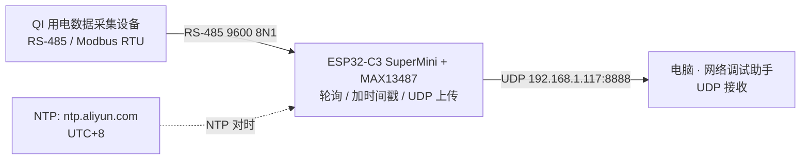

# ESP32-C3 替换树莓派网关项目任务书 v0.1

| 项目 | 内容 |
| --- | --- |
| 文档名称 | ESP32-C3 替换树莓派网关项目任务书 |
| 版本 | v0.1（初稿） |
| 文档状态 | 待 Codex 技术审查 |
| 作者 | WorkBuddy（文档角色） |
| 创建日期 | 2026-09-27 |
| 当前阶段 | 阶段一：项目立项与规划 |
| 唯一事实来源 | `04_ai_prompts/00_context.md` |
| 关联文档 | `README.md`（第 4 / 6 / 7 / 8 节） |

> **冲突处理规则**：本文档与 `README.md` 或任何其它材料冲突时，**一律以 `04_ai_prompts/00_context.md` 为准**。
> **本文档定位**：项目立项与规划期的共识载体。凡 `00_context.md` 未记录、且本文档标注 `[待确认]` 的内容，均**不得**作为实现依据。

---

## 1. 项目背景与目标

### 1.1 现状（痛点）

- 现有架构使用**树莓派**作为中间数据采集网关，单台成本 **500-800 元**。
- 采集节点数量多，网关按节点铺开部署，**整体成本过高**，不具备规模化推广条件。
- 树莓派作为纯协议转换/转发用途，算力与系统开销严重冗余，属于"用大炮打蚊子"。

### 1.2 目标

| 项 | 内容 |
| --- | --- |
| 替换方案 | **ESP32-C3 SuperMini（约 50 元）+ MAX13487 RS-485 模块** 替换树莓派网关 |
| 降本幅度 | 单节点网关硬件成本从 500-800 元降至 **约 50 元量级**（[待确认] 最终 BOM 以 `05_hardware/` 为准） |
| 本阶段目标 | 先在**面包板**上跑通原型机，验证数据链路端到端可用 |
| 架构动作 | **重写架构**，不复用树莓派时代的软件方案 |

### 1.3 三层数据流（总览）

```
QI 用电采集设备  --(RS-485 / Modbus RTU)-->  ESP32-C3 网关  --(UDP)-->  电脑网络调试助手
   约 300 元                                  约 50 元 + 485 模块        上层接收端
```

| 层级 | 角色 | 职责 |
| --- | --- | --- |
| L1 底层设备 | QI 用电数据采集设备（约 300 元） | 支持 RS-485 通信，Modbus RTU 协议，作为数据源 |
| L2 中间网关 | ESP32-C3 SuperMini + MAX13487 | **轮询采集 + 加时间戳 + UDP 上传** |
| L3 上层接收 | 电脑上的"网络调试助手" | 通过 UDP 接收数据（内容为"时间戳 + HEX 数据"） |

### 1.4 成功判定（项目级）

原型机在面包板上，能够以 **1 秒周期**持续从 QI 设备采集数据、附加本地时间戳、通过 UDP 稳定送达电脑端，并完成 2 小时连续压力测试。

---

## 2. 项目范围

### 2.1 本阶段**做**（In Scope）

| 编号 | 范围项 | 说明 |
| --- | --- | --- |
| S-01 | RS-485 轮询 | ESP32-C3 通过 MAX13487 周期性向总线发起查询 |
| S-02 | Modbus RTU 解析 | 解析从站回复帧（CRC 校验、功能码/数据域提取） |
| S-03 | NTP 对时 | 从 `ntp.aliyun.com` 同步，时区 **东八区 UTC+8** |
| S-04 | UDP 上传 | 将"时间戳 + HEX 数据"发往电脑端网络调试助手 |
| S-05 | 1 秒非阻塞循环 | 用 `millis()` 实现，禁止 `delay()` 阻塞主循环 |
| S-06 | 面包板原型 | 全部验证在面包板 + 杜邦线上完成，不上 PCB |

### 2.2 本阶段**不做**（Out of Scope）

以下内容明确排除在本阶段之外，**不得**在阶段一至阶段三的实现中出现：

| 编号 | 排除项 | 备注 |
| --- | --- | --- |
| N-01 | MQTT | 本阶段不引入任何 MQTT Broker / 客户端 |
| N-02 | HTTP / HTTP Server | 不做 REST 接口、不做 Web 配置页 |
| N-03 | 云平台对接 | 不做任何云端上行（阿里云 / 腾讯云 / 自建服务器均不做） |
| N-04 | 成品 PCB | 不画板、不打样，仅面包板原型 |
| N-05 | 锂电池供电 | 本阶段不启用 HW566 的锂电池供电通路，由电脑 USB 供电 |
| N-06 | 多节点 / 多从站组网 | 本阶段只验证**单从站**链路（[待确认] 多从站轮询是否纳入后续阶段） |
| N-07 | 树莓派侧兼容改造 | 不做旧网关的向后兼容 |

### 2.3 范围变更规则

任何超出 2.1 范围的新增需求，必须先回到 `00_context.md` 由用户确认更新，再进入本文档变更记录，**不允许**在执行过程中口头扩范围。

---

## 3. 角色与职责

| 角色 | 定位 | 职责 | 明确不做 |
| --- | --- | --- | --- |
| **用户** | 现场执行者 | 硬件接线、烧录、观察现象、提供日志 | 不负责写代码、不负责写提示词 |
| **总控 AI** | 项目指挥 | 拆解任务、写提示词、审查代码、排障 | 不亲自写下位机业务代码 |
| **Codex** | 代码执行者 | 在工程目录写 / 改代码、编译 | 不改文档决策、不改 `00_context.md` |
| **WorkBuddy** | 文档执行者 | 查资料、写文档、整理测试用例 | **不写 ESP32 业务代码** |

### 3.1 交接物约定

| 上游 → 下游 | 交接物 |
| --- | --- |
| 用户 → 总控 AI | 硬件照片、串口日志、现场现象描述 |
| 总控 AI → Codex | 任务拆解 + 提示词（含目标、约束、验收点） |
| Codex → 用户 | 可编译工程 + 烧录指令 + 预期现象 |
| 用户 → WorkBuddy | 运行日志（存入 `03_logs/`）、异常现象 |
| WorkBuddy → 总控 AI | 文档、测试用例、验收记录 |

### 3.2 协作纪律

- 信息流**单向顺序流转**，跨角色信息不得私自跳级；冲突一律回到 `00_context.md` 裁决。
- 同一时刻**只允许一个角色改动同一类文件**：`01_firmware/` 归 Codex，`02_docs/` `06_tests/` 归 WorkBuddy，`00_context.md` 归用户。

---

## 4. 系统架构与数据流

### 4.1 架构图



### 4.2 网络与端口

| 项 | 值 | 状态 |
| --- | --- | --- |
| 网关侧联网方式 | WiFi（STA 模式） | 确定 |
| WiFi 频段要求 | **2.4GHz**（ESP32-C3 不支持 5GHz） | 确定 |
| ESP32 目标 IP | 由路由器 DHCP 分配 | [待确认] 是否需固定 |
| UDP 目标 IP | `192.168.1.117` | **占位符**，阶段二固化为常量 |
| UDP 目标端口 | `8888` | **占位符**，阶段二固化为常量 |
| 485 串口参数 | 9600，8N1（Modbus RTU） | 波特率"暂定"，[待确认] 真机值 |

### 4.3 1 秒循环数据流（软件主流程）

| 步 | 动作 | 关键约束 |
| --- | --- | --- |
| 4.1 | 向 485 总线发送 Modbus RTU 查询指令 | 测试帧见 6.4；后续替换为 QI 真实协议 |
| 4.2 | 接收 485 设备回复数据 | **接收超时 300ms**，避免死循环 |
| 4.3 | 解析回复数据并拼接时间戳 | 格式：`YYYY-MM-DD HH:MM:SS \| HEX数据` |
| 4.4 | 通过 UDP 发送到电脑网络调试助手 | 目标见 4.2，均为占位符 |
| 4.5 | 等待下一次 1 秒定时触发 | 非阻塞，不占用主循环等待 |

---

## 5. 硬件清单与致命接线规范

### 5.1 硬件清单

| 器件 | 型号 / 规格 | 供电 | 备注 |
| --- | --- | --- | --- |
| 主控板 | **ESP32-C3 SuperMini** | 3.3V 逻辑 | 使用 `HardwareSerial(1)`，**RX=GPIO20，TX=GPIO21** |
| 扩展底板 | **HW566 V0.0.1** 扩展板 | 提供 5V / 3.3V / 锂电池供电接口 | **面包板阶段先不用**，由电脑 USB 供电；留到阶段四/五上锂电池时再用 |
| 通信模块 | **MAX13487** RS-485 模块 | **+5V** | AutoDirection 自动方向控制，无需 DE/RE 控制引脚 |
| 采集设备 | QI 用电数据采集设备（约 300 元） | — | RS-485 / Modbus RTU，真机接入属 M5 |
| 调试工具 | USB 转 485 模块 | — | 用于 M3 物理回环 / M4 电脑模拟从站 |

**供电路径（面包板阶段）**：电脑 USB → ESP32-C3 SuperMini → SuperMini 的 **5V 引脚** → MAX13487。
HW566 V0.0.1 在面包板阶段**不接入**，此决定已由总控确认。

### 5.2 ⚠️ 致命接线警告（原样保留，必须遵守）

> 1. ⚠️ **共地**：ESP32、MAX13487、USB转485模块、电源，所有 GND 必须连在一起。
> 2. ⚠️ **电平转换（极其重要）**：MAX13487 的 RXD 输出是 5V 电平，绝对不能直接连 ESP32 的 RX (GPIO20)。必须加电阻分压。正确分压：1kΩ接RXD，2kΩ接GND，交点接GPIO20（电压约3.33V）。严禁使用 2k接RXD，1k接GND（电压仅1.67V，ESP32无法识别高电平）。
> 3. ⚠️ **供电**：MAX13487 必须接 5V，ESP32-C3 接 3.3V。
> 4. ⚠️ **总线偏置**：MAX13487 模块自带 4.7kΩ 偏置电阻和 120Ω 终端电阻。
> 5. ⚠️ **EN引脚**：悬空或接3.3V（自动收发）。

### 5.3 接线自检清单（上电前逐项打勾）

- [ ] 所有模块 GND 已共地（含 USB 转 485）
- [ ] RXD → 1kΩ → GPIO20，且 1kΩ 与 2kΩ 交点接 GPIO20（**不是** 2k 接 RXD）
- [ ] MAX13487 接 5V，ESP32-C3 接 3.3V
- [ ] EN 悬空或接 3.3V
- [ ] 未接入 HW566 及锂电池
- [ ] A/B 线未接反（[待确认] 模块丝印 A/B 定义，需实物核对方位）

---

## 6. 软件功能需求

### 6.1 功能需求清单

| ID | 功能 | 需求描述 | 约束 / 备注 |
| --- | --- | --- | --- |
| FR-01 | WiFi 联网 | ESP32-C3 以 STA 模式连接 2.4GHz 局域网，获得与电脑同网段的 IP | **凭据不写明文**：`SSID` / 密码由 `01_firmware/esp32c3_gateway/secrets.h` 承载，**不入库**，`.gitignore` 已忽略 |
| FR-02 | NTP 对时 | 从 `ntp.aliyun.com` 同步时间，时区 **UTC+8**，获得准确本地时间 | 断电重启后需具备重新对时能力 |
| FR-03 | RS-485 通信 | 通过 MAX13487 收发，波特率 9600，8N1 | MAX13487 自动收发，无需额外控制引脚；波特率"暂定"，[待确认] 真机参数 |
| FR-04 | Modbus RTU 解析 | 组装请求帧、按 300ms 超时收帧、CRC 校验、提取数据域 | 不使用第三方库或使用情形 [待确认] |
| FR-05 | UDP 上传 | 将"时间戳 + HEX 数据"发给电脑网络调试助手 | 目标 `192.168.1.117:8888` 为**占位符** |
| FR-06 | 1 秒非阻塞循环 | 基于 `millis()` 的 1 秒周期调度 | **禁止** `delay()` 阻塞式实现 |

### 6.2 时间戳格式（固定）

```
YYYY-MM-DD HH:MM:SS | HEX数据
```

示例（示意，非真实数据）：

```
2026-09-27 16:58:43 | 01 03 04 00 00 00 00 FB 7B
```

### 6.3 通信参数汇总

| 参数 | 值 | 来源 |
| --- | --- | --- |
| NTP 服务器 | `ntp.aliyun.com` | 00_context 四.2 |
| 时区 | UTC+8（东八区） | 00_context 四.2 |
| 485 波特率 | 9600 | 00_context 四.3（"暂定"） |
| 数据位/校验/停止位 | 8N1 | 00_context 四.3 |
| 收帧超时 | **300ms** | 00_context 四.4.2 |
| UDP 目标 | `192.168.1.117:8888` | 00_context 四.4.4（**占位符**） |

### 6.4 测试帧（阶段三使用，后续替换为 QI 真实协议）

```
{0x01, 0x03, 0x00, 0x00, 0x00, 0x02, 0xC4, 0x0B}
```

- 用途：链路自测（M3 / M4），验证请求组装、CRC、超时、解析全流程。
- **该帧为测试帧，非 QI 设备真实指令**。QI 真实寄存器地址与查询指令格式见第 11 节 `[待确认]`。
- 接收超时 **300ms**。

### 6.5 明确禁止的实现方式

- ❌ 使用 `delay(1000)` 之类阻塞调用实现"1 秒循环"
- ❌ 将 WiFi 凭据硬编码进 `.ino` / `.h`（非 `secrets.h`）文件
- ❌ 从站无响应时无限等待（必须有 300ms 超时兜底）
- ❌ 引入 MQTT / HTTP / 云平台相关依赖（见 2.2）

---

## 7. 阶段与里程碑

### 7.1 里程碑定义

| 里程碑 | 名称 | 对应项目阶段 | 交付核心 |
| --- | --- | --- | --- |
| **M0** | 任务书冻结 | 阶段一 项目立项与规划 | 本文件评审通过并冻结 |
| **M1** | 环境搭建 | 阶段二 环境搭建与基建 | 软件、硬件、COM 号、IP、2.4GHz 同网段全部确认 |
| **M2** | WiFi / NTP / UDP 联通 | 阶段三 分模块验证 | 纯软链路打通（不含 485） |
| **M3** | 485 物理回环 | 阶段三 分模块验证 | 串口物理层收发正确 |
| **M4** | 电脑模拟 Modbus 从站 | 阶段三 分模块验证 | 协议层解析正确 |
| **M5** | 接入 QI 真机 | 阶段三 分模块验证 | 真实数据上链 |
| **M6** | 系统集成与 2 小时压力测试 | 阶段四 系统集成与稳定性 | 非阻塞状态机 + 异常处理 + 稳定性达标 |
| **M7** | 验收结项 | 阶段五 项目验收与结项 | 成本对比、交付物整理、演示 |

### 7.2 里程碑推进顺序


**铁律**：顺序推进，**先软后硬、先模拟后真机**。上一里程碑未通过验收（见第 9 节），不得启动下一个。

### 7.3 M1 环境搭建的展开项（防遗漏）

| 项 | 内容 | 当前状态 |
| --- | --- | --- |
| 软件 | Arduino IDE 2.3.10 已安装（Windows） | 已具备 |
| 开发板包 | ESP32 开发板包 | **卡在 `esp-x32@2601`，未安装成功** |
| COM 号 | 烧录串口号查询 | 待查询 |
| 电脑 IP | 192.168.1.117 | 已知，[待确认] 是否稳定 |
| 网段 | ESP32（2.4GHz）与电脑（5GHz）**必须同一局域网 / 同一网段** | **未验证** |
| 硬件 | ESP32-C3 SuperMini、HW566 V0.0.1、MAX13487、面包板 | 已就位（已拍照确认） |

---

## 8. 交付物与目录结构

### 8.1 工程目录

```
ESP32_C3_Gateway/
├─ 01_firmware/               固件工程（唯一可编译产物来源）
│  └─ esp32c3_gateway/        ESP32-C3 RS-485 采集网关固件主工程
├─ 02_docs/                   设计文档、协议说明、接线说明、调试记录
├─ 03_logs/                   串口日志、抓包、调试输出（不入库）
├─ 04_ai_prompts/             与 AI 协作使用的提示词、上下文模板
├─ 05_hardware/               原理图、PCB、BOM、器件手册、引脚分配表
├─ 06_tests/                  测试用例、测试脚本、测试报告
├─ README.md                  项目总览
└─ .gitignore                 Git 忽略规则
```

| 目录 | 职责 | 是否入库 |
| --- | --- | --- |
| `01_firmware/` | 全部固件源代码与工程配置 | 是（编译产物除外） |
| `02_docs/` | 文档、图纸外的说明性材料 | 是 |
| `03_logs/` | 运行时日志、临时调试数据 | 否（仅保留目录） |
| `04_ai_prompts/` | AI 协作提示词与上下文文件 | 是 |
| `05_hardware/` | 硬件资料 | 是（大文件建议另存） |
| `06_tests/` | 测试资产 | 是 |

> 目录编号使用两位数字前缀以固定排序，**请勿改名**。

### 8.2 分阶段交付物

| 里程碑 | 交付物 | 建议路径 |
| --- | --- | --- |
| M0 | 项目任务书（本文档） | `02_docs/01_项目任务书.md` |
| M1 | 环境搭建记录（Com 号、IP、开发板包版本、网段确认） | `02_docs/02_环境搭建记录.md` |
| M1 | 引脚分配表 / 接线图 | `05_hardware/接线说明.md` |
| M2 | WiFi / NTP / UDP 连通测试记录 + 串口日志 | `02_docs/03_网络联通记录.md`、`03_logs/` |
| M3 | 485 回环测试记录（发帧 / 收帧 HEX 对照） | `02_docs/04_485回环记录.md` |
| M4 | 模拟从站测试用例 + 结果 | `06_tests/`、`02_docs/05_模拟从站记录.md` |
| M5 | QI 协议说明（寄存器 / 指令，**待确认后填写**） | `02_docs/06_QI协议说明.md` |
| M5 | 真机联调记录 | `02_docs/07_真机联调记录.md` |
| M6 | 压力测试报告（2 小时） | `06_tests/压力测试报告.md` |
| M6 | 固件工程（可编译） | `01_firmware/esp32c3_gateway/` |
| M7 | 成本对比表（树莓派 vs ESP32-C3） | `02_docs/08_成本对比.md` |
| M7 | 交付物清单 + 演示材料 | `02_docs/09_验收结项.md` |

### 8.3 交付物命名与提交约定

- 提交信息格式：`阶段N: 简述`，例如 `阶段1: 新增项目任务书初稿`
- 日志文件统一放 `03_logs/`，不入库；需长期留存的结论必须转写到 `02_docs/` 或 `06_tests/`。

---

## 9. 验收标准

### 9.1 分阶段验收表

| 里程碑 | 应观察到的现象 | 应留存的日志 | 成功条件 |
| --- | --- | --- | --- |
| **M0** 任务书冻结 | 本文档存在于 `02_docs/01_项目任务书.md`，状态由"待 Codex 技术审查"变为"已冻结" | 无需 | 13 个章节齐全、Codex 技术审查通过、用户确认冻结 |
| **M1** 环境搭建 | Arduino IDE 能选中 ESP32-C3 开发板；串口列表出现 COM 口；能完成一次空程序编译烧录 | Arduino 编译 + 上传日志（存 `03_logs/`） | 开发板包安装成功（不再卡 `esp-x32@2601`）；COM 号确定；电脑 IP 确定；ESP32 与电脑处于同一 2.4GHz 网段可互通 |
| **M2** WiFi/NTP/UDP 联通 | 串口打印出同步后的本地时间（UTC+8）；网络调试助手**每条 1 秒**收到一个 UDP 包 | 串口日志 + 网络调试助手抓取记录 | 连续 ≥ 60s 每秒一包无中断；时间戳与真实时间偏差 ≤ 1s（[待确认] 阈值）；UDP 目标参数在代码中为常量 |
| **M3** 485 物理回环 | 总线回环（TX→RX 短接或经 USB 转 485 自环）时，ESP32 发出什么就能收回什么 | 发帧 / 收帧 HEX 对照日志 | 收发字节**完全一致**、CRC 正确、无丢包、无死机 |
| **M4** 电脑模拟 Modbus 从站 | ESP32 发出测试帧，电脑模拟从站返回合法响应；串口打印解析出的数值 | 请求帧与响应帧 HEX 日志 | 测试帧 `{0x01,0x03,0x00,0x00,0x00,0x02,0xC4,0x0B}` 获得合法响应并通过 CRC 校验；从站不回包时 **300ms 超时**正常触发且不阻塞下一周期 |
| **M5** 接入 QI 真机 | 串口与网络调试助手中出现 QI 设备的真实测量数据 | 真机响应帧 HEX 存档 | 使用 `[待确认]` 的真实寄存器指令可稳定读数；数据与 QI 设备本地显示一致（[待确认] 对照方式） |
| **M6** 系统集成与压力测试 | 连续运行 **2 小时**，无重启、无卡死、UDP 持续到达 | 2 小时串口日志 + UDP 端抓包文件 | 重启次数 0；循环周期抖动在 [待确认] 阈值内；丢包率在 [待确认] 阈值内；断网 / 从站无响应等异常可自恢复 |
| **M7** 验收结项 | 现场演示成功；成本对比结论明确（约 50 元 vs 500-800 元） | 验收记录 + 成本对比表 | 8.2 交付物齐全；成本对比完成；用户确认验收 |

### 9.2 通用验收纪律

1. **无日志 = 未通过**。任何里程碑的"通过"必须附带可回溯的日志或截图，日志存 `03_logs/`。
2. **现象优先于解释**。以实测现象为唯一依据，不接受"理论上应该可以"。
3. **可复现**。验收动作必须能被重复执行并得到相同结果。
4. 阈值类指标（丢包率、抖动、时间偏差）当前均为 `[待确认]`，需在 M0 冻结前由 Codex / 总控补定，否则以"无异常即可"暂记。

---

## 10. 风险与应对

| ID | 风险 | 影响 | 概率 | 应对措施 | 责任方 |
| --- | --- | --- | --- | --- | --- |
| R-01 | **QI 寄存器未知**：真实 Modbus 寄存器地址与查询指令格式未确认 | 无法通过 M5；若凭猜测写死寄存器将产生错误数据且难以察觉 | 高 | 先完成 M2-M4 全链路（用测试帧），并行查阅说明书 / 询问老师；**严禁猜测寄存器**；协议确认后单独出 `02_docs/06_QI协议说明.md` | 用户 + 总控 AI |
| R-02 | **开发板包安装卡在 `esp-x32@2601`** | M1 无法闭环，后续全部阻塞 | 高（已发生） | 切换国内镜像 / 手动下载板包离线安装 / 改用离线包；必要时确认是否需要改用 PlatformIO；安装过程日志留档 | 用户 + 总控 AI |
| R-03 | **5GHz / 2.4GHz 网段不一致**：电脑连 5GHz，ESP32 仅支持 2.4GHz | WiFi 连不上或不在同一网段，UDP 收不到 | 高 | M1 阶段先验证路由器 2.4GHz 可用且与电脑同一网段；必要时为 ESP32 单独开 2.4GHz SSID；将 IP / 网段固化为常量 | 用户 + 总控 AI |
| R-04 | **明文凭据历史**：早期材料可能残留 WiFi SSID / 密码明文 | 凭据泄露；`.gitignore` 只忽略未来提交，不清理历史 | 中 | 凭据统一收敛到 `secrets.h` 且不入库；检查 `README.md`、`00_context.md`、Git 历史中是否残留明文，如有需用户确认后清理；后续文档一律写"见 secrets.h" | WorkBuddy + 用户 |
| R-05 | **模型内部漂移**：多 AI 协作中上下文不一致，导致实现与任务书偏离 | 返工、接线或协议参数被"想当然"修改 | 中 | `00_context.md` 为唯一事实来源，每次动手前先读；本文档只做引用不做复述；出现分歧以 `00_context.md` 裁决并记入第 13 节变更记录 | 全部角色 |

---

## 11. 待确认盲区

> 本节**直接引用** `README.md` 第 8 节"当前盲区/待办"与 `04_ai_prompts/00_context.md` 第五节，权威信息以 `00_context.md` 为准。

### 11.1 来自 `00_context.md` 第五节（权威）

**当前进度：**

- 硬件已拍照确认（ESP32-C3 SuperMini、HW566 V0.0.1 扩展板、MAX13487 模块、面包板已就位）。
- Arduino IDE 2.3.10 已安装（Windows）。
- 工程目录结构已规划（01_firmware, 02_docs, 03_logs, 04_ai_prompts, 05_hardware, 06_tests）。
- 任务书待生成，COM 号待查询。
- 电脑实际 IPv4 地址已知：192.168.1.117（但电脑连的是 5GHz 频段，需注意 ESP32 仅支持 2.4GHz）。
- ESP32 开发板包在下载过程中卡在 `esp-x32@2601`，未安装成功。

**待确认盲区：**

- QI 设备的真实 Modbus 寄存器地址和查询指令格式（需查阅说明书或询问老师）。
- 电脑的实际 IPv4 地址和 UDP 监听端口。
- ESP32 开发板包安装、COM 口号查询。

### 11.2 来自 `README.md` 第 8 节（跟踪清单）

1. **QI 设备协议细节未知**：真实 Modbus 寄存器地址与查询指令格式待确认。
2. **电脑 UDP 监听端口未定**：目标 IP 192.168.1.117，端口暂用 8888 占位。
3. **ESP32 开发板包未安装成功**：下载卡在 `esp-x32@2601`。
4. **COM 口号待查询**：烧录串口号未知。
5. **网络频段不一致风险**：电脑 5GHz，ESP32 仅支持 2.4GHz。
6. **Modbus 参数未真机验证**：测试帧与 300ms 超时尚未真机验证。
7. **电脑 IP 可能变化**：192.168.1.117 可能随网络变化，需在阶段二固化。
8. **WiFi 凭据不入库**：SSID / 密码由 `secrets.h` 承载，`.gitignore` 已忽略。

### 11.3 本文档新增待确认项（需在 M0 冻结前回应）

| 编号 | 待确认事项 | 关联章节 |
| --- | --- | --- |
| Q-01 | 阈值类指标：UDP 丢包率、循环周期抖动、NTP 时间偏差的可接受范围 | 9.1 M2 / M6 |
| Q-02 | 是否需要在代码中为 ESP32 固定静态 IP | 4.2 |
| Q-03 | 波特率 9600 是否为 QI 真机最终值 | 6.3 / FR-03 |
| Q-04 | MAX13487 模块 A/B 丝印定义与 QI 设备 A/B 的对应关系 | 5.3 |
| Q-05 | 是否限定使用第三方 Modbus 库，或手写帧组装 | FR-04 |
| Q-06 | 多从站轮询是否纳入本项目后续阶段 | 2.2 N-06 |
| Q-07 | Git 历史中是否存在明文 WiFi 凭据残留 | R-04 |
| Q-08 | M5 阶段如何与 QI 设备本地显示做数据一致性对照 | 9.1 M5 |

---

## 12. AI 协作与指令规范

1. **唯一事实来源**：`04_ai_prompts/00_context.md` 是本项目唯一事实来源。**每次动手前先读它**。
2. **一次只推进一个最小可验证目标**。禁止一次性铺开多个模块。
3. **角色隔离**：Codex **只写代码 / 编译**，不写文档决策；WorkBuddy **只查资料 / 写文档 / 整理测试用例**，不写 ESP32 业务代码。
4. **冲突裁决**：任何冲突一律以 `00_context.md` 为准；`README.md`、本文档与其它材料与之冲突时均服从。
5. **不得擅改**：`00_context.md` 由用户维护，任何角色不得擅自改写；如需修改，先由用户确认。
6. **需求不明先问**：凡是 `[待确认]` 项，实现前必须先向用户确认，不得自行假设。

---

## 13. 变更记录

| 版本 | 日期 | 作者 | 状态 | 变更内容 |
| --- | --- | --- | --- | --- |
| v0.1 | 2026-09-27 | WorkBuddy | 待 Codex 技术审查 | 初稿。依据 `04_ai_prompts/00_context.md` 与 `README.md` 编写，覆盖项目背景与目标、范围、角色职责、架构与数据流、硬件与接线规范、软件功能需求、阶段与里程碑（M0-M7）、交付物与目录结构、验收标准、风险与应对、待确认盲区、AI 协作规范。未包含任何 QI 真实寄存器信息，未涉及业务代码实现。 |

**待审查要点（提请 Codex）**：见本节之后附"Codex 技术审查建议清单"（另附于提交说明中）。

---

## 附录 A. 术语与缩写

| 术语 | 说明 |
| --- | --- |
| QI | 用电数据采集设备，RS-485 / Modbus RTU 从站，约 300 元 |
| SuperMini | ESP32-C3 SuperMini，本项目主控板，3.3V 逻辑 |
| HW566 V0.0.1 | 扩展底板，提供 5V / 3.3V / 锂电池供电接口，面包板阶段不使用 |
| MAX13487 | RS-485 收发模块，+5V 供电，AutoDirection 自动方向控制 |
| Modbus RTU | 工业串行通信协议，本项目用于 ESP32 与 QI / 模拟从站通信 |
| 8N1 | 8 数据位、无校验、1 停止位 |
| 非阻塞循环 | 基于 `millis()` 的定时调度，不使用 `delay()` 阻塞 |
| 占位符 | 当前值仅为临时占位，需在阶段二固化为常量 |

## 附录 B. 溯源映射（便于审查）

| 本文档章节 | 事实来源 |
| --- | --- |
| 1 项目背景与目标 | 00_context 一 / 二；README 2.1-2.2 |
| 2 项目范围 | 00_context 四 / 六；本文档归纳（"不做"项为显式排除） |
| 3 角色与职责 | 00_context 一（角色分工）；README 2.3 |
| 4 系统架构与数据流 | 00_context 二 / 四；README 2.2 / 6.4 |
| 5 硬件清单与接线规范 | 00_context 三；README 6.1-6.2 |
| 6 软件功能需求 | 00_context 四；README 6.3-6.4 |
| 7 阶段与里程碑 | 00_context 六；README 2.4（M0-M7 为本文档细化） |
| 8 交付物与目录结构 | README 3 / 5（分阶段交付物为本文档细化） |
| 9 验收标准 | 本文档新增（阈值项标 `[待确认]`） |
| 10 风险与应对 | 00_context 五；README 8（应对措施为本文档新增） |
| 11 待确认盲区 | README 8；00_context 五（直接引用） |
| 12 AI 协作与指令规范 | 00_context 一；README 7 |
| 13 变更记录 | 本文档 |
