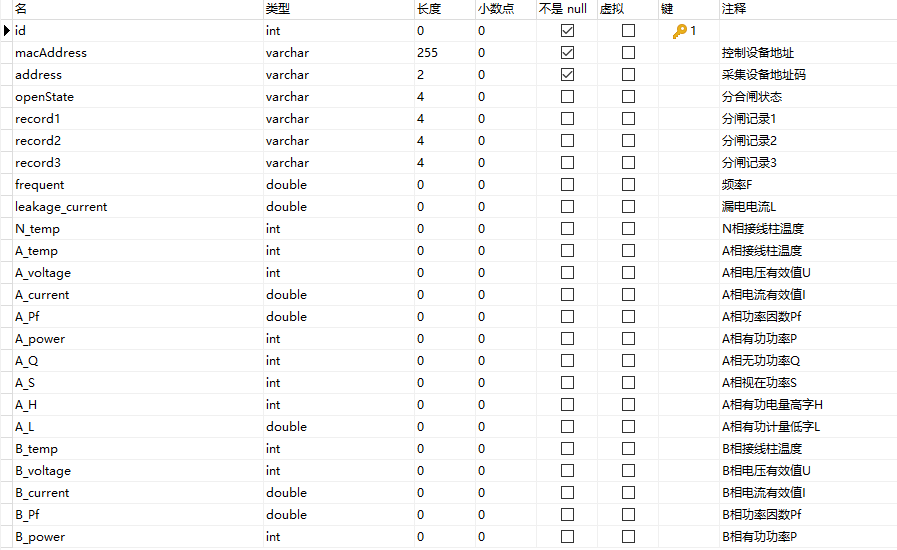
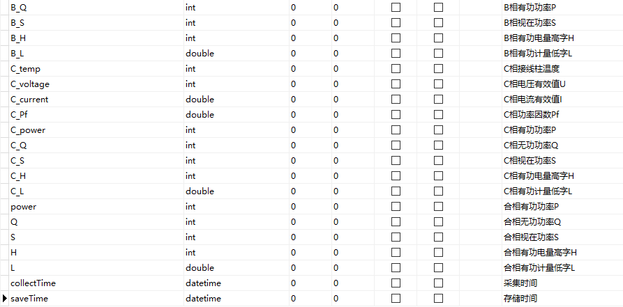

id：用电记录编号，int型，主键，非空，自动递增，每条记录的唯一标识；

macAddress：控制设备mac地址，varchar型，非空，用于标识当前控制数据采集的设备；

address：采集设备地址码，varchar型，非空，用于标识数据采集设备，范围从01-FF；

openState：开关分合闸状态，varchar型，高字节：本地锁止：0x01,无锁：0，低字节：分闸：0x0F,合闸：0xF0；

record1：分闸记录1，varchar型，用于记录前第9-12次分闸原因，F：无，1：过流 2：漏电，3：过温 4：过载，5：过压 6：欠压，7：远程 8：模组，9：失压 B:限电；

record2：分闸记录2，varchar型，用于记录前第5-8次分闸原因；

record3：分闸记录3，varchar型，用于记录前第1-4次分闸原因；

frequent：频率F，double型，范围0-100（单位：Hz），精度0.1；

leakage_current：漏电电流L，double型，范围0-1（单位：A），精度0.001；

N_temp：板载温度，int型，范围-40-160（单位：摄氏度），精度1；

A_temp：A相接线柱温度，int型，范围-40-160（单位：摄氏度），精度1；

A_voltage：A相电压，int型，范围0-600（单位：V），精度1；

A_current：A相电流，double型，范围0- 655.35（单位：A），精度0.01；

A_Pf：A相功率因数Pf，double型，范围0-1（单位：0.01），精度0.01；

A_power：A相有功功率P，int型，范围0-65535（单位：W），精度1；

A_Q：A相无功功率Q，int型，范围0-65535（单位：VAR），精度1；

A_S：A相视在功率S，int型，范围0-65535（单位：VA），精度1；

A_H：A相有功电量高字H，int型，范围1-999999999；

A_L：A相有功计量低字L，double型，单位度，精度0.001；

A相总电量计算公式为：（A_H\*65536）/1000+A_L，单位度，精度0.001；

B_temp：B相接线柱温度，int型，范围-40-160（单位：摄氏度），精度1；

B_voltage：B相电压，int 型，范围0-600（单位：V），精度1；

B_current：B相电流，double型，范围0- 655.35（单位：A），精度0.01；

B_Pf：B相功率因数Pf，double型，范围0-1（单位：0.01），精度0.01；

B_power：B相有功功率P，int型，范围0-65535（单位：W），精度1；

B_Q：B相无功功率Q，int型，范围0-65535（单位：VAR），精度1；

B_S：B相视在功率S，int型，范围0-65535（单位：VA），精度1；

B_H：B相有功电量高字H，int型，范围1-999999999；

B_L：B相有功计量低字L，double型，单位度，精度0.001；

B相总电量计算公式为：（B_H\*65536）/1000+B_L，单位度，精度0.001；

C_temp：C相接线柱温度，int型，范围-40-160（单位：摄氏度），精度1；

C_voltage：C相电压，int 型，范围0-600（单位：V），精度1；

C_current：C相电流，double型，范围0- 655.35（单位：A），精度0.01；

C_Pf：C相功率因数Pf，double型，范围0-1（单位：0.01），精度0.01；

C_power：C相有功功率P，int型，范围0-65535（单位：W），精度1；

C_Q：C相无功功率Q，int型，范围0-65535（单位：VAR），精度1；

C_S：C相视在功率S，int型，范围0-65535（单位：VA），精度1；

C_H：C相有功电量高字H，int型，范围1-999999999；

C_L：C相有功计量低字L，double型，单位度，精度0.001；

C相总电量计算公式为：（C_H\*65536）/1000+C_L，单位度，精度0.001；

power：合相有功功率P，int型，范围0-65535（单位：W），精度1；

Q：合相无功功率Q，int型，范围0-65535（单位：VAR），精度1；

S：合相视在功率S，int型，范围0-65535（单位：VA），精度1；

H：合相有功电量高字H，int型，范围1-999999999；

L：合相有功计量低字L，double型，单位度，精度0.001；

总电量计算公式为：（H\*65536）/1000+L，单位度，精度0.001；

collectTime：数据采集时间，datetime型，记录数据采集程序从采集设备中采集数据的时间；

saveTime：数据存储时间，datetime型，每条记录存储时自动记录当前时间。
